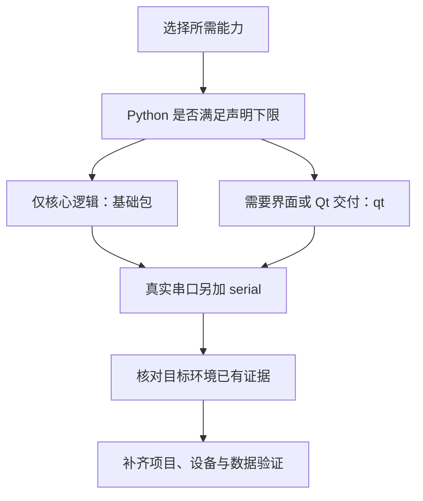

# 版本与兼容

展示页帮助判断功能是否合适，本页帮助判断能力能否接入当前项目。精确依赖、升级行为和环境矩阵统一维护在包文档。

## 包版本

| 能力包 | 当前版本 | 版本依据 |
| --- | --- | --- |
| `python.desktop` / `common-tech-framework-desktop` | `0.2.0` | [包配置](../packages/python/desktop/pyproject.toml) |

## 源码版本

| 版本身份 | 记录要求 |
| --- | --- |
| commit / wheel 来源 | 记录实际安装来源；网页的源码入口固定到构建提交 |
| 相同包版本的不同提交 | 可能包含不同修复，不能只记录包版本号 |

## 运行环境

| 环境 | 当前声明 | 使用条件 |
| --- | --- | --- |
| Python | `>=3.11` | 当前包安装下限；更高版本没有因此自动取得验证结论 |
| Qt 事件环境 | 使用 Qt 组件或 Qt 交付时需要 | Qt 线程使用；控件需要 `QApplication`，不能以离屏测试代替实机外观 |

## 运行依赖

| 依赖选择 | 具体要求 | 使用范围 |
| --- | --- | --- |
| 基础包 | 无第三方运行依赖 | 无界面逻辑及应用注入的后端 |
| `qt` | `PyQt5>=5.15` | 当前 Qt 组件与单实例路径；不等于 PyQt6/PySide 兼容 |
| `serial` | `pyserial>=3.5` | 默认串口工厂；驱动、端口权限与设备协议仍由应用提供 |

## 应用数据版本

| 数据身份 | 接入责任 |
| --- | --- |
| 数据库 schema / 迁移清单 | 应用自行定义和验证，不能以包 `0.2.0` 代替业务库版本 |
| 回退路径 | 应用验证备份恢复或反向迁移；框架不自动提供业务降级 |

## 按项目条件选择

| 你的情况 | 下一步 |
| --- | --- |
| 只用查询、授权、CRUD 控制器、日志或 SQLite | 安装基础包，从 [快速开始](快速开始.md) 开始 |
| 使用 Qt 表格、表单、导航、异步搜索或单实例锁 | 安装 `qt`；确认 Qt 线程、事件循环和窗口环境 |
| 接入真实串口或打印机 | 阅读对应指南，准备系统驱动、权限和协议适配；模拟 Demo 不替代实机验收 |
| 既有项目从旧来源或 0.1.0 切换 | 固定目标 commit，检查 [兼容变化与降级](../packages/python/desktop/docs/升级与兼容.md) |
| 项目使用 Python 3.10、PyQt6 或 PySide | 不在当前声明的直接接入路径内；先评估适配，不能仅改依赖名当作兼容 |
| 使用 Windows 或其他尚未留存验证的环境 | 依赖可安装与目标平台验收分开，按 [验证矩阵](../packages/python/desktop/docs/升级与兼容.md#声明与验证矩阵) 补证 |

## 怎样读验证记录

声明下限表示包配置允许的范围；工作流表示计划执行的环境；某次测试记录只证明该次提交、解释器和依赖组合。离屏 Qt 不证明真实窗口、打印或设备驱动，浏览器交互也不执行 Python。

[完整依赖与资源条件](../packages/python/desktop/docs/架构与依赖.md) · [升级与验证矩阵](../packages/python/desktop/docs/升级与兼容.md) · [历史验证记录](../packages/python/desktop/docs/验证记录.md) · [快速开始](快速开始.md)
