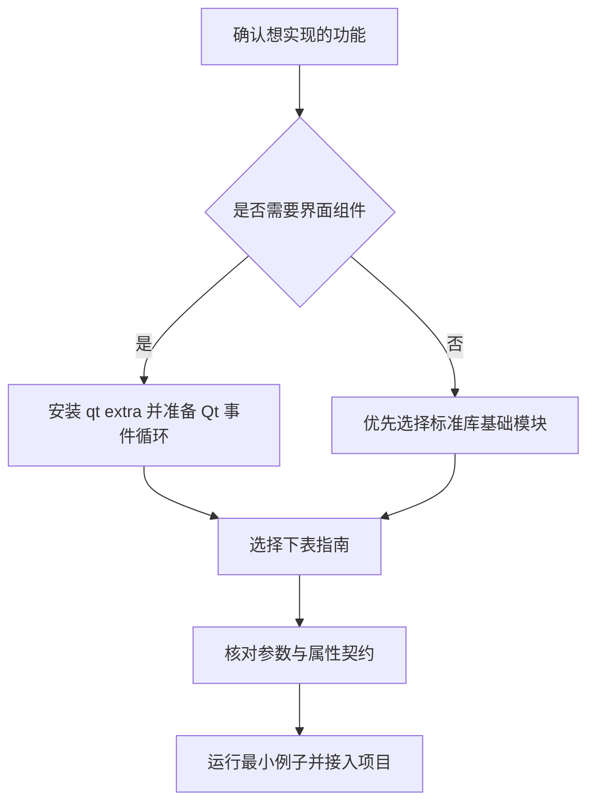

# 能力地图

当前包为 `python.desktop`。此表提供人工导航，机器检索使用 [catalog.json](../catalog.json)；模块的额外依赖与行为以契约为准。

## 如何选择

| 环境路径 | 能力 |
| --- | --- |
| 标准库基础能力 | auth、crud、diagnostics、printing、query、services、storage |
| Qt 界面 / 交付 | background、crud_page、feedback、filters、forms、navigation、table |
| 按使用方式启用依赖 | runtime 的路径 / JSON 无 Qt；SingleInstance 需 Qt；transport 的真实串口需 pyserial，注入假句柄不需要 |

详细版本下限与验证范围见 [版本与兼容](版本与兼容.md)。浏览器中的模拟只对应部分交互场景，不执行这些 Python 模块。

## 全部能力

| 能力 | 稳定 ID | 权威文档 |
| --- | --- | --- |
| 数据表格与分页 | `desktop.table` | [指南](../packages/python/desktop/docs/guides/table.md) · [契约](../packages/python/desktop/docs/contracts/table.md) |
| 配置表单与详情 | `desktop.forms` | [指南](../packages/python/desktop/docs/guides/forms.md) · [契约](../packages/python/desktop/docs/contracts/forms.md) |
| 筛选与联想输入 | `desktop.filters` | [指南](../packages/python/desktop/docs/guides/filters.md) · [契约](../packages/python/desktop/docs/contracts/filters.md) |
| 基础反馈控件 | `desktop.feedback` | [指南](../packages/python/desktop/docs/guides/feedback.md) · [契约](../packages/python/desktop/docs/contracts/feedback.md) |
| 懒加载页面导航 | `desktop.navigation` | [指南](../packages/python/desktop/docs/guides/navigation.md) · [契约](../packages/python/desktop/docs/contracts/navigation.md) |
| 批量打印调度 | `desktop.printing` | [指南](../packages/python/desktop/docs/guides/printing.md) · [契约](../packages/python/desktop/docs/contracts/printing.md) |
| 密码校验与访问授权 | `desktop.auth` | [指南](../packages/python/desktop/docs/guides/auth.md) · [契约](../packages/python/desktop/docs/contracts/auth.md) |
| 资料管理协调与页面 | `desktop.crud` | [指南](../packages/python/desktop/docs/guides/crud.md) · [契约](../packages/python/desktop/docs/contracts/crud.md) |
| 字节传输与串口 | `desktop.transport` | [指南](../packages/python/desktop/docs/guides/transport.md) · [契约](../packages/python/desktop/docs/contracts/transport.md) |
| 服务生命周期 | `desktop.services` | [指南](../packages/python/desktop/docs/guides/services.md) · [契约](../packages/python/desktop/docs/contracts/services.md) |
| SQLite迁移备份恢复 | `desktop.storage` | [指南](../packages/python/desktop/docs/guides/storage.md) · [契约](../packages/python/desktop/docs/contracts/storage.md) |
| 参数化查询工具 | `desktop.query` | [指南](../packages/python/desktop/docs/guides/query.md) · [契约](../packages/python/desktop/docs/contracts/query.md) |
| 目录配置与单实例 | `desktop.runtime` | [指南](../packages/python/desktop/docs/guides/runtime.md) · [契约](../packages/python/desktop/docs/contracts/runtime.md) |
| 结构化日志与审计 | `desktop.diagnostics` | [指南](../packages/python/desktop/docs/guides/diagnostics.md) · [契约](../packages/python/desktop/docs/contracts/diagnostics.md) |
| 有界后台任务与最新请求交付 | `desktop.background` | [指南](../packages/python/desktop/docs/guides/background.md) · [契约](../packages/python/desktop/docs/contracts/background.md) |

数据表格分组同时关联 `table` 与 `query`；独立查询工具也有自己的分组。后台任务属于 Qt 交付能力，取消是协作式，适合只关心最新结果的查询。

[运行示例](../demo/README.md) · [组合场景](组合场景.md) · [完整模块导航](../packages/python/desktop/docs/README.md)
