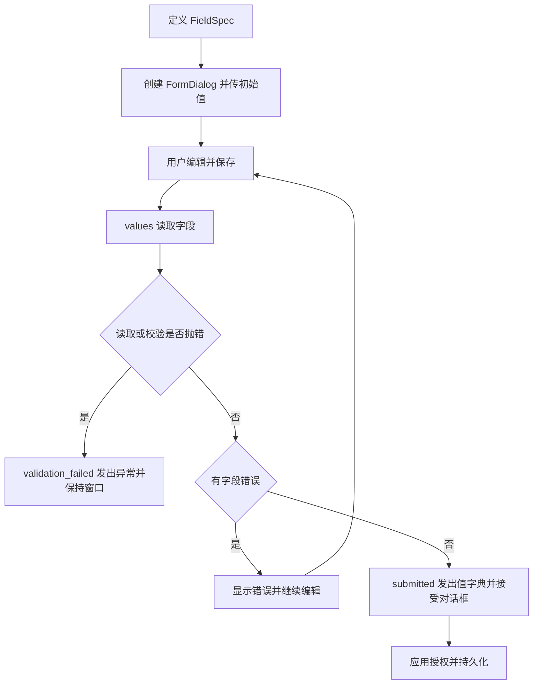

# desktop.forms

## 用途与范围

冻结的字段配置，默认 text、非必填；支持多行、整数、布尔、选项和 custom，custom 必须提供工厂与读取器，非法 kind 抛 ValueError。

导入模块为 `ctf_desktop.forms`，下列参数、返回值和资源条件均对应本页模块。

## 模块信息

| 标识项 | 本模块信息 |
| --- | --- |
| API 命名空间 | `desktop.forms` |
| Python 导入 | `ctf_desktop.forms` |
| 所属发行包 | `common-tech-framework-desktop` |
| 包导入名 | `ctf_desktop` |

## 运行环境

| 环境项 | 要求 | 说明 |
| --- | --- | --- |
| Python | >=3.11 | 安装声明；不把更高版本的可安装性当作实际验证。 |
| Qt 运行环境 | 需要事件循环 | 示例使用 QApplication；控件/执行器由创建它的 Qt 线程使用。 |

## 依赖要求

### 运行依赖

| 依赖 | 版本 / 状态 | 使用条件 |
| --- | --- | --- |
| PyQt5 | >=5.15 | 使用 qt extra；本模块导入 Qt API。 |

### 构建依赖

| 依赖 | 声明下限 | 使用阶段 |
| --- | --- | --- |
| setuptools | >=77 | 从源码安装/构建时由 pip 隔离构建环境使用。 |
| wheel | 未声明下限 | 发行包构建依赖，不是应用运行依赖。 |

## 版本信息

| 版本项 | 当前值 / 识别方式 | 说明 |
| --- | --- | --- |
| 能力包版本 | `0.2.0` | 对应 pyproject.toml 与包版本常量。 |
| 模块版号 | 随所属包发布 | 本模块没有另行声明独立的模块版本号。 |
| 源码身份 | 网页头部的构建提交或所读 Git 版本 | 接入时记录实际安装 commit/wheel 来源；相同包版本不能代替源码身份。 |

## 兼容要求

| 兼容维度 | 本页具体要求与边界 |
| --- | --- |
| 本模块接口与升级 | 0.2.0 通过 validation_failed 报告读取/校验异常并保留窗口；普通校验不通过显示字段错误，不应当作异常信号。 |
| GUI 适配范围 | 当前使用 PyQt5，没有 PyQt6/PySide 适配承诺；目标系统真实窗口需应用验证。 |
| 验证边界 | 依赖下限不等于所有版本组合已验证；Python/Qt、目标系统与真实设备须按实际环境确认。 |

## 安装与导入

以下命令在本仓库根目录执行，使用当前源码安装，不假定 PyPI 已发布同名版本。

```bash
python -m pip install "./packages/python/desktop[qt]"
```

导入路径：`ctf_desktop.forms`。

## 调用前置条件

| 调用方责任 | 要求 |
| --- | --- |
| 字段定义 | FieldSpec.key 唯一非空；kind 与对应控件匹配。 |
| 自定义字段 | kind=custom 时同时提供 widget_factory 和 value_reader。 |
| 保存入口 | submitted 表示本地校验通过；权限、业务验证和持久化仍由应用处理。 |

## 调用签名与默认值

### 构造入口

| 入口 | 输入签名 |
| --- | --- |
| `FormDialog` | `FormDialog(title: str, fields: Sequence[FieldSpec], initial=None, parent=None)` |
| `DetailView` | `DetailView(fields: Sequence[FieldSpec], values: Mapping[str, Any], parent=None)` |

### 方法

| 入口 | 输入签名 |
| --- | --- |
| `FormDialog.values` | `FormDialog.values()` |

### 函数

| 入口 | 输入签名 |
| --- | --- |
| `validate_values` | `validate_values(fields: Sequence[FieldSpec], values: Mapping[str, Any])` |

签名只列输入，返回结果另表说明；类型标注不意味着每个参数都在运行时强制校验。

## 配置字段与只读属性

### 配置字段

### FieldSpec 字段

| 字段 | 类型 | 默认值 | 含义 |
| --- | --- | --- | --- |
| `key` | `str` | 必填 | 表单字段键；对话框要求非空且唯一。 |
| `label` | `str` | 必填 | 应用提供的字段标签文字。 |
| `kind` | `str` | `'text'` | 控件种类：text、multiline、integer、boolean、choice、custom；custom 同时需要 widget_factory 和 value_reader。 |
| `required` | `bool` | `False` | 是否作必填检查；False 默认关闭，0 和 False 本身不算缺失。 |
| `choices` | `tuple[tuple[Any, str], ...]` | `()` | (value, label)选项 tuple；显示 label，读取时返回 value。 |
| `validate` | <code>Callable[[Any], str &#124; None] &#124; None</code> | `None` | 字段校验函数(value)，返回错误文字或 None；抛错不是普通校验失败。 |
| `widget_factory` | <code>Callable[[Any], QWidget] &#124; None</code> | `None` | custom 字段工厂，接收初始值并返回 QWidget；须与 value_reader 同时提供。 |
| `value_reader` | <code>Callable[[QWidget], Any] &#124; None</code> | `None` | 读取 custom QWidget 的当前值，异常会上抛或被对话框失败信号报告。 |

冻结值对象禁止直接重新赋值字段；含映射或其他对象时，不代表内部对象被深度冻结。
### 只读属性

本模块未额外声明 @property 只读访问器；值对象字段与调用参数分别在相应表中说明。

## 输入参数

### validate_values 输入参数

| 参数 | 声明类型 | 默认值 | 传入方式 | 含义 |
| --- | --- | --- | --- | --- |
| `fields` | `Sequence[FieldSpec]` | 必填 | 位置或关键字 | FieldSpec 配置序列；键应唯一且非空。 |
| `values` | `Mapping[str, Any]` | 必填 | 位置或关键字 | 候选值映射；按 FieldSpec 执行必填及字段校验，不写入任何存储。 |

### FormDialog 构造参数

| 参数 | 声明类型 | 默认值 | 传入方式 | 含义 |
| --- | --- | --- | --- | --- |
| `title` | `str` | 必填 | 位置或关键字 | 应用提供的窗口、页面或列标题；不作为 SQL 表达式。 |
| `fields` | `Sequence[FieldSpec]` | 必填 | 位置或关键字 | FieldSpec 配置序列；键应唯一且非空。 |
| `initial` | 未标注 | `None` | 位置或关键字 | 表单初始值映射；默认 None，0 与 False 不应被替换为空字符串。 |
| `parent` | 未标注 | `None` | 位置或关键字 | Qt 父对象，默认 None；子控件/对象的所有权遵循 Qt 父子关系。 |

### DetailView 构造参数

| 参数 | 声明类型 | 默认值 | 传入方式 | 含义 |
| --- | --- | --- | --- | --- |
| `fields` | `Sequence[FieldSpec]` | 必填 | 位置或关键字 | FieldSpec 配置序列；键应唯一且非空。 |
| `values` | `Mapping[str, Any]` | 必填 | 位置或关键字 | 本接口声明的值映射；校验、写入与显示按所在接口约定执行。 |
| `parent` | 未标注 | `None` | 位置或关键字 | Qt 父对象，默认 None；子控件/对象的所有权遵循 Qt 父子关系。 |

## 返回值

| 接口 | 返回类型 | 返回结果 |
| --- | --- | --- |
| `validate_values` | `dict[str, str]` | 字段键到错误文字的新字典；空字典表示本次校验没有字段错误。 |
| `FormDialog.values` | `dict[str, Any]` | 当前字段值的新字典，保留整数/布尔类型并按控件读取文字或选项值。 |

## 信号

| 信号 | 载荷类型（按顺序） | 发出条件与含义 |
| --- | --- | --- |
| `FormDialog.submitted` | `dict` | 本地校验通过的值字典；之后接受对话框，不代表数据库已保存。 |
| `FormDialog.validation_failed` | `object` | 读取器或校验器抛出的异常；窗口保持打开，普通字段错误不走此信号。 |

## 错误与边界

| 触发情况 | 错误或结果 | 调用方处理 |
| --- | --- | --- |
| 字段 kind、键或 custom 配置非法 | ValueError | 在创建界面前核验字段定义。 |
| 普通必填/校验未通过 | 字段错误映射或窗口内提示 | 修正输入，不写入数据。 |
| 读取器或校验器抛错 | validate_values 直接上抛；对话框发出 validation_failed | 保留窗口并由应用记录错误。 |

### 错误、扩展与边界

不支持的 `kind`、缺少自定义工厂 / reader 属于配置错误，构造时失败。校验回调只返回用户可读错误或 `None`；异常交给 `validation_failed` 记录。服务端写入前仍应再次验证权限与数据。

组件没有跨字段依赖引擎或持久化；自定义控件资源由 Qt 父子关系和应用清理代码管理。不要在校验回调中阻塞 GUI 或执行写入。

[完整契约与最小例子](../contracts/forms.md) · [交互桌面示例](../../examples/qt_showcase.py) · [相关测试](../../tests/test_review_qt.py)

## 线程与资源

| 资源 | 拥有者 | 线程与释放要求 |
| --- | --- | --- |
| 字段控件/对话框 | Qt 父对象或创建者 | 独立对话框在 finally close/deleteLater，自定义资源由应用释放。 |

## 调用流程



## FieldSpec

稳定标识：`desktop.forms.FieldSpec`

冻结的字段配置，默认 text、非必填；支持多行、整数、布尔、选项和 custom，custom 必须提供工厂与读取器，非法 kind 抛 ValueError。

## validate_values

稳定标识：`desktop.forms.validate_values`

返回字段键到错误文字的映射；0 和 False 满足必填约束，应用校验函数抛错则上抛，不写数据。

## FormDialog

稳定标识：`desktop.forms.FormDialog`

在 Qt 线程创建和使用，要求字段键非空且唯一；有效保存发出 submitted，读取或校验异常发出 validation_failed 并保持窗口，取消为拒绝。

## FormDialog.values

稳定标识：`desktop.forms.FormDialog.values`

读取当前字段并建立新字典；普通文字去空白，选项返回 data，整数/布尔保留类型，自定义读取器异常上抛。

## DetailView

稳定标识：`desktop.forms.DetailView`

按字段和值建立只读标签；None 显示空文字，其他值转字符串，生命周期由 Qt 父对象管理。

## 最小调用示例

```python
from PyQt5.QtWidgets import QApplication
from ctf_desktop.forms import FieldSpec, FormDialog, validate_values

app = QApplication.instance() or QApplication([])
fields = [
    FieldSpec("name", "名称", required=True),
    FieldSpec("copies", "份数", kind="integer", required=True,
              validate=lambda value: "份数不能为负" if value < 0 else None),
    FieldSpec("enabled", "启用", kind="boolean", required=True),
    FieldSpec("mode", "模式", kind="choice", choices=(("draft", "草稿"), ("ready", "就绪"))),
]
assert validate_values(fields, {"name": "", "copies": 0, "enabled": False}) == {"name": "必填"}
dialog = FormDialog("编辑示例", fields, {"name": "样例", "copies": 0, "enabled": False})
try:
    values = dialog.values()
    assert values["copies"] == 0
    assert values["enabled"] is False
    assert validate_values(fields, values) == {}
    # 真实应用：dialog.submitted.connect(你的授权与保存入口)，然后显示窗口。
finally:
    dialog.close()
    dialog.deleteLater()
```

<span id="qt-信号" class="legacy-anchor" aria-hidden="true"></span>

## 验证与源码依据

实现依据：[forms.py](../../src/ctf_desktop/forms.py)；版本与依赖声明：[pyproject.toml](../../pyproject.toml)。

| 验证文件 | 用途 |
| --- | --- |
| [test_qt.py](../../tests/test_qt.py) | 源码标注的契约或回归入口；按改动范围选用。 |
| [test_qt_contracts.py](../../tests/test_qt_contracts.py) | 源码标注的契约或回归入口；按改动范围选用。 |
| [test_review_qt.py](../../tests/test_review_qt.py) | 源码标注的契约或回归入口；按改动范围选用。 |

在已按本页安装依赖的仓库根目录运行：

```bash
python packages/python/desktop/examples/check_contract_examples.py --qt
```

示例检查只执行本仓库文档代码；pytest 回归另需 test extra（pytest>=8），Qt 回归还需 qt extra。浏览器 mock、离屏示例与真实 GUI/设备验收是不同验证范围。
