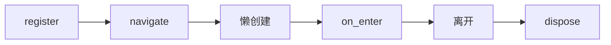

# desktop.navigation

## 用途与范围

冻结的路由键、标题和无参 QWidget 工厂；页面的 on_enter/on_leave/dispose 钩子由应用实现。

导入模块为 `ctf_desktop.navigation`，下列参数、返回值和资源条件均对应本页模块。

## 模块信息

| 标识项 | 本模块信息 |
| --- | --- |
| API 命名空间 | `desktop.navigation` |
| Python 导入 | `ctf_desktop.navigation` |
| 所属发行包 | `common-tech-framework-desktop` |
| 包导入名 | `ctf_desktop` |

## 运行环境

| 环境项 | 要求 | 说明 |
| --- | --- | --- |
| Python | >=3.11 | 安装声明；不把更高版本的可安装性当作实际验证。 |
| Qt 运行环境 | 需要事件循环 | 示例使用 QApplication；控件/执行器由创建它的 Qt 线程使用。 |

## 依赖要求

### 运行依赖

| 依赖 | 版本 / 状态 | 使用条件 |
| --- | --- | --- |
| PyQt5 | >=5.15 | 使用 qt extra；本模块导入 Qt API。 |

### 构建依赖

| 依赖 | 声明下限 | 使用阶段 |
| --- | --- | --- |
| setuptools | >=77 | 从源码安装/构建时由 pip 隔离构建环境使用。 |
| wheel | 未声明下限 | 发行包构建依赖，不是应用运行依赖。 |

## 版本信息

| 版本项 | 当前值 / 识别方式 | 说明 |
| --- | --- | --- |
| 能力包版本 | `0.2.0` | 对应 pyproject.toml 与包版本常量。 |
| 模块版号 | 随所属包发布 | 本模块没有另行声明独立的模块版本号。 |
| 源码身份 | 网页头部的构建提交或所读 Git 版本 | 接入时记录实际安装 commit/wheel 来源；相同包版本不能代替源码身份。 |

## 兼容要求

| 兼容维度 | 本页具体要求与边界 |
| --- | --- |
| 本模块接口与升级 | 生命周期重入被拒绝；关闭尝试所有页面并汇总失败。不同页面的业务状态恢复由应用实现。 |
| GUI 适配范围 | 当前使用 PyQt5，没有 PyQt6/PySide 适配承诺；目标系统真实窗口需应用验证。 |
| 验证边界 | 依赖下限不等于所有版本组合已验证；Python/Qt、目标系统与真实设备须按实际环境确认。 |

## 安装与导入

以下命令在本仓库根目录执行，使用当前源码安装，不假定 PyPI 已发布同名版本。

```bash
python -m pip install "./packages/python/desktop[qt]"
```

导入路径：`ctf_desktop.navigation`。

## 调用前置条件

| 调用方责任 | 要求 |
| --- | --- |
| 页面工厂 | PageSpec.create 是无参工厂，返回 QWidget；注册时不创建页面。 |
| 页面钩子 | 应用按需实现 on_enter/on_leave/dispose；在 Qt 线程完成且不重入导航。 |
| 退出路径 | 应用退出前显式 dispose，并处理清理失败；不要仅移除可见窗口。 |

## 调用签名与默认值

### 构造入口

| 入口 | 输入签名 |
| --- | --- |
| `PageHost` | `PageHost(parent=None)` |

### 方法

| 入口 | 输入签名 |
| --- | --- |
| `PageHost.register` | `PageHost.register(spec: PageSpec)` |
| `PageHost.navigate` | `PageHost.navigate(key: str)` |
| `PageHost.dispose` | `PageHost.dispose()` |

签名只列输入，返回结果另表说明；类型标注不意味着每个参数都在运行时强制校验。

## 配置字段与只读属性

### 配置字段

### PageSpec 字段

| 字段 | 类型 | 默认值 | 含义 |
| --- | --- | --- | --- |
| `key` | `str` | 必填 | 非空且唯一的路由注册键。 |
| `title` | `str` | 必填 | 应用提供的窗口、页面或列标题；不作为 SQL 表达式。 |
| `create` | `Callable[[], QWidget]` | 必填 | 无参工厂，返回 QWidget；直到第一次 navigate 才调用。 |

冻结值对象禁止直接重新赋值字段；含映射或其他对象时，不代表内部对象被深度冻结。
### 只读属性

本模块未额外声明 @property 只读访问器；值对象字段与调用参数分别在相应表中说明。

## 输入参数

### PageHost 构造参数

| 参数 | 声明类型 | 默认值 | 传入方式 | 含义 |
| --- | --- | --- | --- | --- |
| `parent` | 未标注 | `None` | 位置或关键字 | Qt 父对象，默认 None；子控件/对象的所有权遵循 Qt 父子关系。 |

### PageHost.register 输入参数

| 参数 | 声明类型 | 默认值 | 传入方式 | 含义 |
| --- | --- | --- | --- | --- |
| `spec` | `PageSpec` | 必填 | 位置或关键字 | 对应的 PageSpec 或 ServiceSpec 配置；按声明类型使用。 |

### PageHost.navigate 输入参数

| 参数 | 声明类型 | 默认值 | 传入方式 | 含义 |
| --- | --- | --- | --- | --- |
| `key` | `str` | 必填 | 位置或关键字 | 已注册路由键，成功返回缓存或新建的页面。 |

## 返回值

| 接口 | 返回类型 | 返回结果 |
| --- | --- | --- |
| `PageHost.register` | `None` | None；没有业务返回值。对应操作与失败边界分别在接口说明和错误表中列明。 |
| `PageHost.navigate` | `QWidget` | 目标路由的 QWidget；同一路由成功创建后复用缓存实例。 |
| `PageHost.dispose` | `None` | None；没有业务返回值。对应操作与失败边界分别在接口说明和错误表中列明。 |

## 信号

| 信号 | 载荷类型（按顺序） | 发出条件与含义 |
| --- | --- | --- |
| `PageHost.page_changed` | `str` | 成功切换后的路由键。 |
| `PageHost.navigation_failed` | `str, object` | 侧栏导航失败的路由键与异常对象。 |

## 错误与边界

| 触发情况 | 错误或结果 | 调用方处理 |
| --- | --- | --- |
| 路由键为空或重复 | ValueError | 启动时核对注册清单。 |
| 构造或进入钩子失败 | 异常上抛，侧栏入口发出 navigation_failed | 框架清理新页并尝试恢复旧页，应用报告原始失败。 |
| 清理失败/生命周期重入 | RuntimeError | 检查异常链或清理说明，不在钩子里再次导航或销毁。 |

### 失败与边界

新页进入失败会清理并移除失败实例，再尝试恢复旧页；原始错误保留，恢复或清理错误追加说明。dispose 会尝试所有页，最后汇总首个失败。

不提供异步路由或回调重入调度。生命周期重入会抛 RuntimeError；不要在 on_enter/on_leave/dispose 里再次 navigate/dispose，可用 QTimer 安排当前回调完成后的导航。侧栏进入失败会发 navigation_failed(key,error)，直接 navigate 的错误由调用方捕获。hook 必须短且不阻塞。

## 线程与资源

| 资源 | 拥有者 | 线程与释放要求 |
| --- | --- | --- |
| 缓存页面 | PageHost | 退出前 dispose，尝试全部钩子并安排 deleteLater；工厂失败前的内部资源自行释放。 |

工厂与所有 hook 在 Qt 线程；dispose 删除使用 deleteLater，应用需要继续处理延迟删除事件；退出时仍须关闭页面自己启动的后台任务。

## 调用流程



## PageSpec

稳定标识：`desktop.navigation.PageSpec`

冻结的路由键、标题和无参 QWidget 工厂；页面的 on_enter/on_leave/dispose 钩子由应用实现。

## PageHost

稳定标识：`desktop.navigation.PageHost`

Qt 线程页面注册和生命周期容器；成功后发出 page_changed，侧栏导航失败发出 navigation_failed，拒绝生命周期回调重入，应用退出前应 dispose。

## PageHost.register

稳定标识：`desktop.navigation.PageHost.register`

注册非空且唯一的路由和侧栏项；非法或重复键抛 ValueError，此时不构造页面。

## PageHost.navigate

稳定标识：`desktop.navigation.PageHost.navigate`

返回缓存或新建 QWidget，钩子成功后才通知切换；新页面失败时清理并移除，尝试恢复旧页，保留原始错误及清理说明；拒绝生命周期重入。

## PageHost.dispose

稳定标识：`desktop.navigation.PageHost.dispose`

尝试所有清理钩子，始终移除并 deleteLater 全部页面、清空当前状态；清理结束后汇总首个失败为 RuntimeError，之后可重复清理。

## 最小调用示例

示例使用虚构数据和临时资源，不连接真实设备或业务存储。 需要先安装 qt 依赖；创建 QApplication 后再建立控件。

```python
from PyQt5.QtWidgets import QApplication, QWidget
from ctf_desktop.navigation import PageHost, PageSpec
app = QApplication.instance() or QApplication([])
widget = PageHost()
widget.register(PageSpec("sample", "Sample", QWidget))
try:
    first = widget.navigate("sample")
    assert widget.navigate("sample") is first
finally:
    widget.dispose()
    widget.close()
```

<span id="qt-信号" class="legacy-anchor" aria-hidden="true"></span>

## 验证与源码依据

实现依据：[navigation.py](../../src/ctf_desktop/navigation.py)；版本与依赖声明：[pyproject.toml](../../pyproject.toml)。

| 验证文件 | 用途 |
| --- | --- |
| [test_qt.py](../../tests/test_qt.py) | 源码标注的契约或回归入口；按改动范围选用。 |
| [test_qt_contracts.py](../../tests/test_qt_contracts.py) | 源码标注的契约或回归入口；按改动范围选用。 |
| [test_review_qt.py](../../tests/test_review_qt.py) | 源码标注的契约或回归入口；按改动范围选用。 |

在已按本页安装依赖的仓库根目录运行：

```bash
python packages/python/desktop/examples/check_contract_examples.py --qt
```

示例检查只执行本仓库文档代码；pytest 回归另需 test extra（pytest>=8），Qt 回归还需 qt extra。浏览器 mock、离屏示例与真实 GUI/设备验收是不同验证范围。
