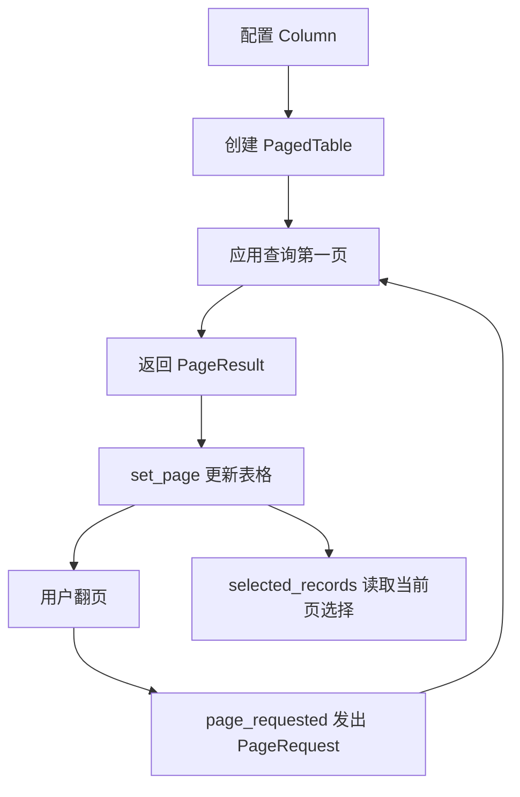

# desktop.table

## 用途与范围

冻结的记录键、列标题及展示回调（默认 str），只负责显示，不表示 SQL 或排序表达式。

导入模块为 `ctf_desktop.table`，下列参数、返回值和资源条件均对应本页模块。

## 模块信息

| 标识项 | 本模块信息 |
| --- | --- |
| API 命名空间 | `desktop.table` |
| Python 导入 | `ctf_desktop.table` |
| 所属发行包 | `common-tech-framework-desktop` |
| 包导入名 | `ctf_desktop` |

## 运行环境

| 环境项 | 要求 | 说明 |
| --- | --- | --- |
| Python | >=3.11 | 安装声明；不把更高版本的可安装性当作实际验证。 |
| Qt 运行环境 | 需要事件循环 | 示例使用 QApplication；控件/执行器由创建它的 Qt 线程使用。 |

## 依赖要求

### 运行依赖

| 依赖 | 版本 / 状态 | 使用条件 |
| --- | --- | --- |
| PyQt5 | >=5.15 | 使用 qt extra；本模块导入 Qt API。 |

### 构建依赖

| 依赖 | 声明下限 | 使用阶段 |
| --- | --- | --- |
| setuptools | >=77 | 从源码安装/构建时由 pip 隔离构建环境使用。 |
| wheel | 未声明下限 | 发行包构建依赖，不是应用运行依赖。 |

## 版本信息

| 版本项 | 当前值 / 识别方式 | 说明 |
| --- | --- | --- |
| 能力包版本 | `0.2.0` | 对应 pyproject.toml 与包版本常量。 |
| 模块版号 | 随所属包发布 | 本模块没有另行声明独立的模块版本号。 |
| 源码身份 | 网页头部的构建提交或所读 Git 版本 | 接入时记录实际安装 commit/wheel 来源；相同包版本不能代替源码身份。 |

## 兼容要求

| 兼容维度 | 本页具体要求与边界 |
| --- | --- |
| 本模块接口与升级 | set_page 不自动修正页码或总数，且刷新后不保留选择；大型数据仍应由应用分页，只适配 PyQt5 模型与视图。 |
| GUI 适配范围 | 当前使用 PyQt5，没有 PyQt6/PySide 适配承诺；目标系统真实窗口需应用验证。 |
| 验证边界 | 依赖下限不等于所有版本组合已验证；Python/Qt、目标系统与真实设备须按实际环境确认。 |

## 安装与导入

以下命令在本仓库根目录执行，使用当前源码安装，不假定 PyPI 已发布同名版本。

```bash
python -m pip install "./packages/python/desktop[qt]"
```

导入路径：`ctf_desktop.table`。

## 调用前置条件

| 调用方责任 | 要求 |
| --- | --- |
| 列配置 | 提供非空且键唯一的 Column 序列；display 只格式化，不执行慢 IO。 |
| 查询回调 | 连接 page_requested，取到数据后主动 set_page；构造不会自动查询。 |
| 选择范围 | 换页或刷新会重置选择；批量业务按主键重新授权，不能依赖跨页选中。 |

## 调用签名与默认值

### 构造入口

| 入口 | 输入签名 |
| --- | --- |
| `RecordTableModel` | `RecordTableModel(columns: Sequence[Column], parent=None)` |
| `PagedTable` | `PagedTable(columns: Sequence[Column], page_size: int=20, parent=None)` |

### 方法

| 入口 | 输入签名 |
| --- | --- |
| `RecordTableModel.rowCount` | `RecordTableModel.rowCount(parent=QModelIndex())` |
| `RecordTableModel.columnCount` | `RecordTableModel.columnCount(parent=QModelIndex())` |
| `RecordTableModel.data` | `RecordTableModel.data(index: QModelIndex, role=Qt.DisplayRole)` |
| `RecordTableModel.headerData` | `RecordTableModel.headerData(section: int, orientation: Qt.Orientation, role=Qt.DisplayRole)` |
| `RecordTableModel.set_records` | `RecordTableModel.set_records(records: Sequence[Mapping[str, Any]])` |
| `PagedTable.set_page` | `PagedTable.set_page(page: PageResult)` |
| `PagedTable.selected_records` | `PagedTable.selected_records()` |

签名只列输入，返回结果另表说明；类型标注不意味着每个参数都在运行时强制校验。

## 配置字段与只读属性

### 配置字段

### Column 字段

| 字段 | 类型 | 默认值 | 含义 |
| --- | --- | --- | --- |
| `key` | `str` | 必填 | 记录映射的键；列集合中必须唯一。 |
| `title` | `str` | 必填 | 应用提供的窗口、页面或列标题；不作为 SQL 表达式。 |
| `display` | `Callable[[Any], str]` | `str` | Column 单元格展示函数，默认 str；应快速且无副作用，None 值直接显示空文字。 |

冻结值对象禁止直接重新赋值字段；含映射或其他对象时，不代表内部对象被深度冻结。
### 只读属性

本模块未额外声明 @property 只读访问器；值对象字段与调用参数分别在相应表中说明。

## 可读运行状态

| 状态 | 类型 | 读取含义 |
| --- | --- | --- |
| `PagedTable.request` | `PageRequest` | 当前显示页对应的请求，由 set_page 更新。 |
| `PagedTable.model` | `RecordTableModel` | 当前 Qt 表格模型，数据更新使用 set_page/set_records。 |
| `RecordTableModel.records` | `tuple[Mapping, ...]` | 当前展示行的浅拷贝；嵌套值没有深拷贝。 |

这些是可读取的实例状态；不把直接重新赋值当作受支持的更新接口。

## 输入参数

### RecordTableModel 构造参数

| 参数 | 声明类型 | 默认值 | 传入方式 | 含义 |
| --- | --- | --- | --- | --- |
| `columns` | `Sequence[Column]` | 必填 | 位置或关键字 | 非空 Column 序列，key 唯一，决定列顺序和显示。 |
| `parent` | 未标注 | `None` | 位置或关键字 | Qt 父对象，默认 None；子控件/对象的所有权遵循 Qt 父子关系。 |

### RecordTableModel.rowCount 输入参数

| 参数 | 声明类型 | 默认值 | 传入方式 | 含义 |
| --- | --- | --- | --- | --- |
| `parent` | 未标注 | `QModelIndex()` | 位置或关键字 | Qt 模型父索引；有效父索引表示非根层，本平面模型返回0。 |

### RecordTableModel.columnCount 输入参数

| 参数 | 声明类型 | 默认值 | 传入方式 | 含义 |
| --- | --- | --- | --- | --- |
| `parent` | 未标注 | `QModelIndex()` | 位置或关键字 | Qt 模型父索引；有效父索引表示非根层，本平面模型返回0。 |

### RecordTableModel.data 输入参数

| 参数 | 声明类型 | 默认值 | 传入方式 | 含义 |
| --- | --- | --- | --- | --- |
| `index` | `QModelIndex` | 必填 | 位置或关键字 | 属于当前 RecordTableModel 且在范围内的 QModelIndex。 |
| `role` | 未标注 | `Qt.DisplayRole` | 位置或关键字 | Qt 数据角色；模型按 DisplayRole/UserRole 等约定返回，不支持的角色通常为 None。 |

### RecordTableModel.headerData 输入参数

| 参数 | 声明类型 | 默认值 | 传入方式 | 含义 |
| --- | --- | --- | --- | --- |
| `section` | `int` | 必填 | 位置或关键字 | Qt 表头列号；水平展示时必须处于有效列范围。 |
| `orientation` | `Qt.Orientation` | 必填 | 位置或关键字 | Qt 表头方向；水平 DisplayRole 使用配置标题，其他交给 Qt 基类。 |
| `role` | 未标注 | `Qt.DisplayRole` | 位置或关键字 | Qt 数据角色；模型按 DisplayRole/UserRole 等约定返回，不支持的角色通常为 None。 |

### RecordTableModel.set_records 输入参数

| 参数 | 声明类型 | 默认值 | 传入方式 | 含义 |
| --- | --- | --- | --- | --- |
| `records` | `Sequence[Mapping[str, Any]]` | 必填 | 位置或关键字 | 映射记录序列；成功时保存浅拷贝，转换失败保留已有模型数据。 |

### PagedTable 构造参数

| 参数 | 声明类型 | 默认值 | 传入方式 | 含义 |
| --- | --- | --- | --- | --- |
| `columns` | `Sequence[Column]` | 必填 | 位置或关键字 | 非空 Column 序列，key 唯一；不是数据库查询配置。 |
| `page_size` | `int` | `20` | 位置或关键字 | 每页条数，默认20；PageRequest 要求正整数且不接受 bool。 |
| `parent` | 未标注 | `None` | 位置或关键字 | Qt 父对象，默认 None；子控件/对象的所有权遵循 Qt 父子关系。 |

### PagedTable.set_page 输入参数

| 参数 | 声明类型 | 默认值 | 传入方式 | 含义 |
| --- | --- | --- | --- | --- |
| `page` | `PageResult` | 必填 | 位置或关键字 | 已查询得到的 PageResult；框架不自动查询或纠正业务总数。 |

## 返回值

| 接口 | 返回类型 | 返回结果 |
| --- | --- | --- |
| `RecordTableModel.rowCount` | `int` | 当前显示记录数；有效父索引表示非根层，此时为0。 |
| `RecordTableModel.columnCount` | `int` | 配置列数；有效父索引表示非根层，此时为0。 |
| `RecordTableModel.data` | 未标注；见结果语义 | 有效 UserRole 为记录映射，DisplayRole 为格式化/空文字；非法索引或其他角色为 None。 |
| `RecordTableModel.headerData` | 未标注；见结果语义 | 有效水平 DisplayRole 为列标题；非法列为 None，其他情况由 Qt 基类决定。 |
| `RecordTableModel.set_records` | `None` | None；没有业务返回值。对应操作与失败边界分别在接口说明和错误表中列明。 |
| `PagedTable.set_page` | `None` | None；没有业务返回值。对应操作与失败边界分别在接口说明和错误表中列明。 |
| `PagedTable.selected_records` | `tuple[Mapping[str, Any], ...]` | 按显示行顺序排列的当前页选中记录 tuple；无选择时为空 tuple。 |

## 信号

| 信号 | 载荷类型（按顺序） | 发出条件与含义 |
| --- | --- | --- |
| `PagedTable.page_requested` | `object` | PageRequest 对象；应用查询后调用 set_page，控件不读数据库。 |

## 错误与边界

| 触发情况 | 错误或结果 | 调用方处理 |
| --- | --- | --- |
| 列为空或键重复 | ValueError | 构造前核验列配置。 |
| 记录转换或 display 失败 | 原错误上抛 | 转换失败保留旧模型；先验证展示回调。 |
| 刷新或换页 | 当前选择被重置 | 按主键重新确定批量操作范围。 |

| 情况 | 组件行为 | 应用应处理 |
| --- | --- | --- |
| 空列 / 重复列键 | 构造时 `ValueError` | 启动时核验字段配置 |
| 空数据 | 显示总数 0、至少 1 页；禁止不可用导航 | 用相同条件计算行集与总数 |
| 非法记录在转换时失败 | 既有模型数据不变，不遗留 reset 状态 | 记录查询失败；不要展示为成功空结果 |
| 总数 / 页码与行集不一致 | 不自动修正业务结果 | 仓储返回一致的 `PageResult` |
| 选择跨页或刷新 | 原选择重置 | 批量操作明确选择范围，并按主键重新授权 |
| 展示回调抛错 | 错误上抛 | 先验证格式化逻辑，不在回调中做慢 IO |

没有自动筛选、持久化排序或跨页全选。大型结果应分页；后台线程查询完成后，通过信号回到 Qt 线程更新。

## 线程与资源

| 资源 | 拥有者 | 线程与释放要求 |
| --- | --- | --- |
| 模型与表格 | Qt 父对象 | 在 Qt 线程更新/读取，独立控件用完 close/deleteLater；不持有数据库连接。 |

## 调用流程



## Column

稳定标识：`desktop.table.Column`

冻结的记录键、列标题及展示回调（默认 str），只负责显示，不表示 SQL 或排序表达式。

## RecordTableModel

稳定标识：`desktop.table.RecordTableModel`

Qt 线程的映射记录模型；列不能为空、键不可重复，否则抛 ValueError，set_records 成功后重置模型。

## RecordTableModel.rowCount

稳定标识：`desktop.table.RecordTableModel.rowCount`

父索引有效时返回0（平面模型），否则返回当前记录数。

## RecordTableModel.columnCount

稳定标识：`desktop.table.RecordTableModel.columnCount`

父索引有效时返回0，否则返回配置列数。

## RecordTableModel.data

稳定标识：`desktop.table.RecordTableModel.data`

只接受属于本模型且在范围内的索引；UserRole 返回记录映射，DisplayRole 返回格式化/空文字，非法索引或其他角色返回 None，展示回调错误上抛。

## RecordTableModel.headerData

稳定标识：`desktop.table.RecordTableModel.headerData`

水平 DisplayRole 返回有效列标题，非法列返回 None；其他方向或角色交给 Qt 基类处理。

## RecordTableModel.set_records

稳定标识：`desktop.table.RecordTableModel.set_records`

先转换全部映射，再进入模型重置；转换失败保留原数据且不触发重置，成功时以 tuple 保存浅拷贝并重置选择。

## PagedTable

稳定标识：`desktop.table.PagedTable`

Qt 线程分页表格，page_size 默认20，支持上一页/下一页和扩展行选择；page_requested 把查询交给应用，初始空页禁止不可用导航。

## PagedTable.set_page

稳定标识：`desktop.table.PagedTable.set_page`

显示输入 PageResult 并更新翻页控件；不查询、不自动纠正业务页码或总数，记录映射被浅拷贝。

## PagedTable.selected_records

稳定标识：`desktop.table.PagedTable.selected_records`

按当前显示行顺序返回选中映射 tuple；无选择时为空，不跨页保存选择。

## 最小调用示例

在已安装桌面包及 `qt` 依赖的环境中运行。示例不访问外部数据，退出前关闭控件。

```python
from PyQt5.QtWidgets import QApplication
from ctf_desktop.query import PageRequest, PageResult
from ctf_desktop.table import Column, PagedTable

app = QApplication.instance() or QApplication([])
records = tuple({"name": f"示例 {number}"} for number in range(1, 6))
widget = PagedTable([Column("name", "名称")], page_size=2)

def load(request):
    rows = records[request.offset:request.offset + request.size]
    widget.set_page(PageResult(rows, len(records), request))

widget.page_requested.connect(load)
try:
    load(PageRequest(1, 2))
    assert widget.model.rowCount() == 2
    assert widget.request.number == 1
    assert widget.selected_records() == ()
    # 在真实窗口中，用户点击下一页也会经过这个 load 回调。
    widget.page_requested.emit(PageRequest(2, 2))
    assert widget.model.records[0]["name"] == "示例 3"
finally:
    widget.close()
    widget.deleteLater()
```

<span id="qt-信号" class="legacy-anchor" aria-hidden="true"></span>

## 验证与源码依据

实现依据：[table.py](../../src/ctf_desktop/table.py)；版本与依赖声明：[pyproject.toml](../../pyproject.toml)。

| 验证文件 | 用途 |
| --- | --- |
| [test_qt.py](../../tests/test_qt.py) | 源码标注的契约或回归入口；按改动范围选用。 |
| [test_qt_contracts.py](../../tests/test_qt_contracts.py) | 源码标注的契约或回归入口；按改动范围选用。 |
| [test_review_qt.py](../../tests/test_review_qt.py) | 源码标注的契约或回归入口；按改动范围选用。 |

在已按本页安装依赖的仓库根目录运行：

```bash
python packages/python/desktop/examples/check_contract_examples.py --qt
```

示例检查只执行本仓库文档代码；pytest 回归另需 test extra（pytest>=8），Qt 回归还需 qt extra。浏览器 mock、离屏示例与真实 GUI/设备验收是不同验证范围。
