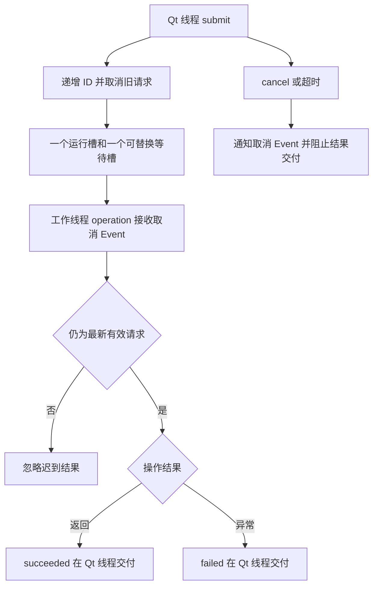

# 后台任务与异步查询

## 用途与范围

将只关心最新结果的读取放到工作线程，并在 Qt 线程交付结果。一个执行槽与一个可替换等待槽限制待处理数量。

提供 operation(cancel_event)，工作线程自行创建和关闭 IO 资源。

## 模块信息

| 标识项 | 本模块信息 |
| --- | --- |
| API 命名空间 | `desktop.background` |
| Python 导入 | `ctf_desktop.background` |
| 所属发行包 | `common-tech-framework-desktop` |
| 包导入名 | `ctf_desktop` |

<span id="接入速查" class="legacy-anchor" aria-hidden="true"></span>

## 运行环境

| 环境项 | 要求 | 说明 |
| --- | --- | --- |
| Python | >=3.11 | 安装声明；不把更高版本的可安装性当作实际验证。 |
| Qt 运行环境 | 需要事件循环 | 示例使用 QApplication；控件/执行器由创建它的 Qt 线程使用。 |

## 依赖要求

### 运行依赖

| 依赖 | 版本 / 状态 | 使用条件 |
| --- | --- | --- |
| PyQt5 | >=5.15 | 使用 qt extra；本模块导入 Qt API。 |

### 构建依赖

| 依赖 | 声明下限 | 使用阶段 |
| --- | --- | --- |
| setuptools | >=77 | 从源码安装/构建时由 pip 隔离构建环境使用。 |
| wheel | 未声明下限 | 发行包构建依赖，不是应用运行依赖。 |

## 版本信息

| 版本项 | 当前值 / 识别方式 | 说明 |
| --- | --- | --- |
| 能力包版本 | `0.2.0` | 对应 pyproject.toml 与包版本常量。 |
| 模块版号 | 随所属包发布 | 本模块没有另行声明独立的模块版本号。 |
| 源码身份 | 网页头部的构建提交或所读 Git 版本 | 接入时记录实际安装 commit/wheel 来源；相同包版本不能代替源码身份。 |

## 兼容要求

| 兼容维度 | 本页具体要求与边界 |
| --- | --- |
| 本模块接口与升级 | 最新请求与有限等待槽，不适用于必须逐条执行的写入/收费/打印；取消与超时不撤销外部副作用，也不强杀阻塞 IO。 |
| GUI 适配范围 | 当前使用 PyQt5，没有 PyQt6/PySide 适配承诺；目标系统真实窗口需应用验证。 |
| 验证边界 | 依赖下限不等于所有版本组合已验证；Python/Qt、目标系统与真实设备须按实际环境确认。 |

完整历史记录可继续查阅[架构与依赖](../架构与依赖.md)和[升级与兼容](../升级与兼容.md)；本模块当前要求已在本页说明。

## 安装与导入

以下命令在本仓库根目录执行，使用当前源码安装，不假定 PyPI 已发布同名版本。

```bash
python -m pip install "./packages/python/desktop[qt]"
```

导入路径：`ctf_desktop.background`。

## 接入准备

| 应用需要提供 | 具体要求 |
| --- | --- |
| 任务函数 | 提供 operation(cancel_event)，工作线程自行创建和关闭 IO 资源。 |
| 结束条件 | 外部 IO 设置有限超时，操作检查 Event；不能依靠执行器强杀线程。 |
| 结果接收 | 在 Qt 线程连接成功、失败、取消和超时信号，以请求 ID 判断当前结果。 |

## 核心入口

| 入口 | 职责 |
| --- | --- |
| `BackgroundTaskRunner` | 由 Qt 线程拥有的最新请求执行器，最多一个执行任务和一个可替换等待项；通过信号交付结果，关闭或父对象销毁会取消任务，不强杀线程。 |

## 请求生命周期



## 调用步骤

| 步骤 | 操作 |
| --- | --- |
| 1 | 在 Qt 线程建立执行器并连接信号 |
| 2 | 提交有界 operation，保留请求 ID |
| 3 | 在工作线程执行并检查取消 Event |
| 4 | 只处理最新有效代次的信号 |
| 5 | 拥有者关闭并等待资源释放 |

## 输入签名

### 构造入口

| 入口 | 输入签名 |
| --- | --- |
| `BackgroundTaskRunner` | `BackgroundTaskRunner(parent=None)` |

### 方法

| 入口 | 输入签名 |
| --- | --- |
| `BackgroundTaskRunner.submit` | <code>BackgroundTaskRunner.submit(operation: Callable[[Event], Any], *, timeout_ms: int &#124; None=None)</code> |
| `BackgroundTaskRunner.cancel` | `BackgroundTaskRunner.cancel()` |
| `BackgroundTaskRunner.close` | `BackgroundTaskRunner.close(*, wait: bool=True)` |

签名只列输入，返回结果另表说明；类型标注不意味着每个参数都在运行时强制校验。

## 配置字段

本模块未声明单独的 dataclass 配置字段；构造参数列在下一节。

## 配置参数与调用参数

### BackgroundTaskRunner 构造参数

| 参数 | 声明类型 | 默认值 | 传入方式 | 含义 |
| --- | --- | --- | --- | --- |
| `parent` | 未标注 | `None` | 位置或关键字 | Qt 父对象，默认 None；子控件/对象的所有权遵循 Qt 父子关系。 |

### BackgroundTaskRunner.submit 输入参数

| 参数 | 声明类型 | 默认值 | 传入方式 | 含义 |
| --- | --- | --- | --- | --- |
| `operation` | `Callable[[Event], Any]` | 必填 | 位置或关键字 | 工作线程调用的 operation(cancel_event)；自行设置 IO 超时、检查取消并释放资源。 |
| `timeout_ms` | <code>int &#124; None</code> | `None` | 仅关键字 | 可选正整数毫秒截止时间；None 不设截止时间，超时不强杀外部 IO。 |

### BackgroundTaskRunner.close 输入参数

| 参数 | 声明类型 | 默认值 | 传入方式 | 含义 |
| --- | --- | --- | --- | --- |
| `wait` | `bool` | `True` | 仅关键字 | 是否等待有界工作线程退出；False 先返回但不代表资源已全部释放。 |

## 只读属性

本模块未额外声明 @property 只读访问器；值对象字段与调用参数分别在相应表中说明。

## 返回值

| 接口 | 返回类型 | 返回结果 |
| --- | --- | --- |
| `BackgroundTaskRunner.submit` | `int` | 当前提交的递增整数请求 ID，用于关联结果与取消/超时通知。 |
| `BackgroundTaskRunner.cancel` | `None` | None；没有业务返回值。对应操作与失败边界分别在接口说明和错误表中列明。 |
| `BackgroundTaskRunner.close` | `None` | None；没有业务返回值。对应操作与失败边界分别在接口说明和错误表中列明。 |

## 信号

| 信号 | 载荷类型（按顺序） | 发出条件与含义 |
| --- | --- | --- |
| `BackgroundTaskRunner.succeeded` | `int, object` | 最新有效请求成功；依次携带请求 ID 与结果值，在 Qt 线程交付。 |
| `BackgroundTaskRunner.failed` | `int, object` | 最新有效请求失败；依次携带请求 ID 与异常对象。 |
| `BackgroundTaskRunner.cancelled` | `int` | 被替换或显式取消的请求 ID，不代表外部 IO 已立即结束。 |
| `BackgroundTaskRunner.timed_out` | `int` | 超时请求 ID；与手动取消分开，迟到结果不再交付。 |

## 错误与边界

| 触发情况 | 错误或结果 | 调用方处理 |
| --- | --- | --- |
| operation 或 timeout_ms 非法 | ValueError | 提交前检查配置。 |
| 已关闭后提交 | RuntimeError | 为新拥有者创建新执行器。 |
| 操作失败/取消/超时 | 对应 failed/cancelled/timed_out 信号 | 按请求 ID 展示结果，仍需等待外部工作释放。 |

### 取消、超时与清理

| 状态 | 用户可见结果 | 资源约束 |
| --- | --- | --- |
| 替换 / 取消 | 旧结果不显示 | 已开始的操作仍须观察 Event；不能依靠取消撤销副作用 |
| 超时 | 发出 `timed_out`，忽略晚到结果 | 外部原生调用仍可能运行；设置它自身的 IO 超时 |
| `close(wait=True)` | 停止新交付并等待退出 | 只能等待有界、可合作的操作；不在 worker 内等待自己 |
| 父对象销毁 | 非阻塞取消 | 不能据此声称第三方 IO 已立即结束 |

不要在工作线程读写 Qt 控件。关闭应用时先取消、再等待任务与其连接释放。测试覆盖正常、异常、取消、超时、队列上限、重入及父对象销毁，入口为 [test_background.py](../../tests/test_background.py)；[公开契约](../contracts/background.md) 给出精确签名。

## 线程与资源

| 资源 | 拥有者 | 线程与释放要求 |
| --- | --- | --- |
| Qt 执行器 | 创建它的 Qt 线程 | close(wait=True) 等待有界工作退出；父对象销毁仅非阻塞取消。 |
| 任务内 IO | operation 自己 | 在工作线程建立并在 finally 关闭，不借用 GUI 线程连接。 |

## 方法、参数与事件

- `BackgroundTaskRunner(parent=None)`：可选 QObject 父对象；Qt 线程创建；父对象销毁会非阻塞取消。
- `submit(operation, *, timeout_ms=None)`：callable；超时默认不设；返回递增 `int` ID；替换旧任务。
- `timeout_ms`：`None` 或 `1..2147483647` 的整数；`bool`、0、负数均不合法；超时阻止晚到交付，不强杀线程。
- `cancel()`：无；取消等待槽，设置工作 Event；无活动请求时可重复调用。
- `close(*, wait=True)`：默认等待 worker 释放；关闭后拒绝 `submit`；`wait=False` 后可再 `close(wait=True)` 等待。
- `succeeded(id, value)`：请求 ID、任意返回值；仅最新有效请求的正常结果。
- `failed(id, error)`：请求 ID、异常对象；仅最新有效请求的操作异常。
- `cancelled(id)`：请求 ID；替换或显式取消的通知。
- `timed_out(id)`：请求 ID；超时通知，与手动取消分开。

`submit` 非法参数在修改状态前抛 `ValueError`；关闭后提交抛 `RuntimeError`。新请求状态先建立，再发送旧请求取消通知，信号回调重入提交时，以回调提交的更新代次为准。

## 与联想输入组合

监听 `LiveSearchComboBox.request_started(request_id, query)`，将联想控件的 ID 与文字保留在结果上下文；Qt 线程收到 runner 结果后调用 `set_results(query, rows, request_id=request_id)`。两个组件各自的 ID 来自独立计数器，不应假定相等。

原 `search_requested(query)` 与不带 ID 的调用保持兼容，但只有文字比较，同一关键词的旧结果没有代次保证。完整绑定见 [后台搜索示例](../../examples/background_search.py) 和 [筛选契约](../contracts/filters.md)。

## 可运行示例：有限任务与安全退出

示例启动 Qt 事件循环等待信号，并设置兜底退出。真实 IO 必须在操作内设置超时、创建并关闭连接；不能借用 GUI 线程的 SQLite 连接。

```python
from PyQt5.QtCore import QEventLoop, QTimer
from PyQt5.QtWidgets import QApplication
from ctf_desktop.background import BackgroundTaskRunner

app = QApplication.instance() or QApplication([])
runner = BackgroundTaskRunner()
loop = QEventLoop()
received = []

def operation(cancel_event):
    if cancel_event.wait(0.01):
        return None
    return ["示例结果"]

def delivered(identity, value):
    received.append((identity, value))
    loop.quit()

runner.succeeded.connect(delivered)
runner.failed.connect(lambda identity, error: loop.quit())
runner.timed_out.connect(lambda identity: loop.quit())
watchdog = QTimer()
watchdog.setSingleShot(True)
watchdog.timeout.connect(loop.quit)
try:
    identity = runner.submit(operation, timeout_ms=1000)
    watchdog.start(2000)
    loop.exec_()
    assert received == [(identity, ["示例结果"])]
finally:
    watchdog.stop()
    runner.close()
```

## 验证与源码依据

实现依据：[background.py](../../src/ctf_desktop/background.py)；版本与依赖声明：[pyproject.toml](../../pyproject.toml)。

| 验证文件 | 用途 |
| --- | --- |
| [test_background.py](../../tests/test_background.py) | 源码标注的契约或回归入口；按改动范围选用。 |

在已按本页安装依赖的仓库根目录运行：

```bash
python packages/python/desktop/examples/check_contract_examples.py --qt
```

示例检查只执行本仓库文档代码；pytest 回归另需 test extra（pytest>=8），Qt 回归还需 qt extra。浏览器 mock、离屏示例与真实 GUI/设备验收是不同验证范围。
