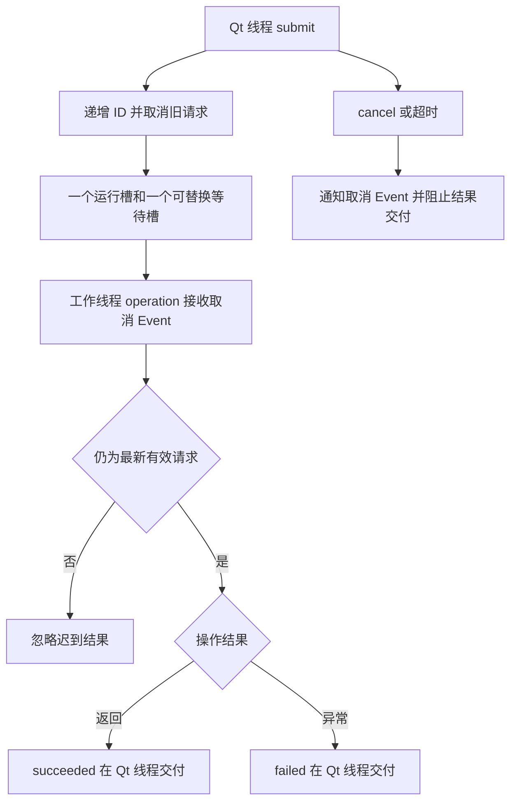

# 后台任务与异步查询

将只关心最新结果的读取放到工作线程，并在 Qt 线程交付结果。一个执行槽与一个可替换等待槽限制待处理数量。

## 接入速查

| 项目 | 要求 / 行为 |
| --- | --- |
| 环境 | Python >= 3.11；`qt` extra，PyQt5 >= 5.15；Qt 事件循环 |
| 导入 | `from ctf_desktop.background import BackgroundTaskRunner` |
| 操作函数 | `operation(cancel_event)`；返回任意值；在工作线程运行 |
| 调度语义 | 最新请求替换旧等待项；旧结果不会再交付 |
| 退出 | 在拥有者线程 `close()`，操作本身须有有限结束条件 |
| 不适用 | 必须逐条执行的写入、收费、打印；不可协作取消的无限 IO |
| 版本 / 兼容 | [依赖](../架构与依赖.md) · [升级](../升级与兼容.md) |

## 请求生命周期



## 方法、参数与事件

| 接口 | 输入 / 默认值 | 返回与行为 |
| --- | --- | --- |
| `BackgroundTaskRunner(parent=None)` | 可选 QObject 父对象 | Qt 线程创建；父对象销毁会非阻塞取消 |
| `submit(operation, *, timeout_ms=None)` | callable；超时默认不设 | 返回递增 `int` ID；替换旧任务 |
| `timeout_ms` | `None` 或 `1..2147483647` 的整数 | `bool`、0、负数均不合法；超时阻止晚到交付，不强杀线程 |
| `cancel()` | 无 | 取消等待槽，设置工作 Event；无活动请求时可重复调用 |
| `close(*, wait=True)` | 默认等待 worker 释放 | 关闭后拒绝 `submit`；`wait=False` 后可再 `close(wait=True)` 等待 |
| `succeeded(id, value)` | 请求 ID、任意返回值 | 仅最新有效请求的正常结果 |
| `failed(id, error)` | 请求 ID、异常对象 | 仅最新有效请求的操作异常 |
| `cancelled(id)` | 请求 ID | 替换或显式取消的通知 |
| `timed_out(id)` | 请求 ID | 超时通知，与手动取消分开 |

`submit` 非法参数在修改状态前抛 `ValueError`；关闭后提交抛 `RuntimeError`。新请求状态先建立，再发送旧请求取消通知，信号回调重入提交时，以回调提交的更新代次为准。

## 可运行示例：有限任务与安全退出

示例启动 Qt 事件循环等待信号，并设置兜底退出。真实 IO 必须在操作内设置超时、创建并关闭连接；不能借用 GUI 线程的 SQLite 连接。

```python
from PyQt5.QtCore import QEventLoop, QTimer
from PyQt5.QtWidgets import QApplication
from ctf_desktop.background import BackgroundTaskRunner

app = QApplication.instance() or QApplication([])
runner = BackgroundTaskRunner()
loop = QEventLoop()
received = []

def operation(cancel_event):
    if cancel_event.wait(0.01):
        return None
    return ["示例结果"]

def delivered(identity, value):
    received.append((identity, value))
    loop.quit()

runner.succeeded.connect(delivered)
runner.failed.connect(lambda identity, error: loop.quit())
runner.timed_out.connect(lambda identity: loop.quit())
watchdog = QTimer()
watchdog.setSingleShot(True)
watchdog.timeout.connect(loop.quit)
try:
    identity = runner.submit(operation, timeout_ms=1000)
    watchdog.start(2000)
    loop.exec_()
    assert received == [(identity, ["示例结果"])]
finally:
    watchdog.stop()
    runner.close()
```

## 与联想输入组合

监听 `LiveSearchComboBox.request_started(request_id, query)`，将联想控件的 ID 与文字保留在结果上下文；Qt 线程收到 runner 结果后调用 `set_results(query, rows, request_id=request_id)`。两个组件各自的 ID 来自独立计数器，不应假定相等。

原 `search_requested(query)` 与不带 ID 的调用保持兼容，但只有文字比较，同一关键词的旧结果没有代次保证。完整绑定见 [后台搜索示例](../../examples/background_search.py) 和 [筛选契约](../contracts/filters.md)。

## 取消、超时与清理

| 状态 | 用户可见结果 | 资源约束 |
| --- | --- | --- |
| 替换 / 取消 | 旧结果不显示 | 已开始的操作仍须观察 Event；不能依靠取消撤销副作用 |
| 超时 | 发出 `timed_out`，忽略晚到结果 | 外部原生调用仍可能运行；设置它自身的 IO 超时 |
| `close(wait=True)` | 停止新交付并等待退出 | 只能等待有界、可合作的操作；不在 worker 内等待自己 |
| 父对象销毁 | 非阻塞取消 | 不能据此声称第三方 IO 已立即结束 |

不要在工作线程读写 Qt 控件。关闭应用时先取消、再等待任务与其连接释放。测试覆盖正常、异常、取消、超时、队列上限、重入及父对象销毁，入口为 [test_background.py](../../tests/test_background.py)；[公开契约](../contracts/background.md) 给出精确签名。
