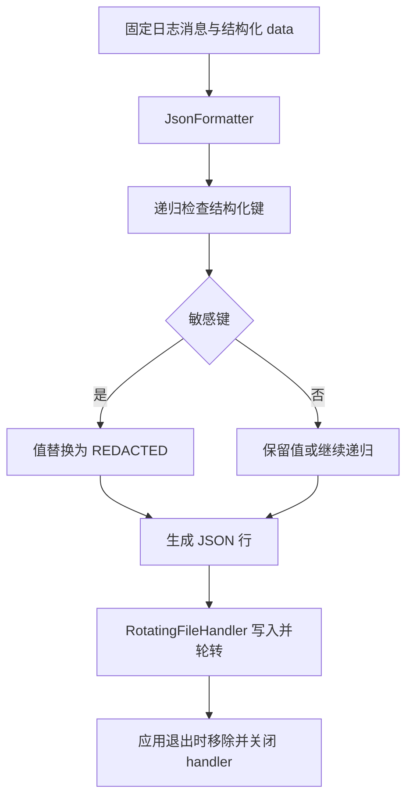

# 结构化日志、脱敏与审计

记录结构化 JSON 日志，并对指定键的值脱敏。审计日志按行追加并 `fsync`，不提供防篡改或跨进程协调。

## 接入速查

| 项目 | 要求 / 行为 |
| --- | --- |
| 环境 | Python >= 3.11；标准库，无 Qt 依赖 |
| 导入 | `ctf_desktop.diagnostics` |
| 脱敏输入 / 输出 | Mapping、list、tuple 递归生成新结构；tuple 输出为 list；普通标量保留 |
| 日志输入 | 固定 `message` + `extra={"data": {...}}` |
| 资源 | `configure_json_logger` 创建的 handlers 由调用方移除并关闭 |
| 版本 / 兼容 | [依赖](../架构与依赖.md) · [升级](../升级与兼容.md) |

## 日志数据流



消息文本不经过上述键脱敏，避免把敏感值拼接到消息。浏览器演示与 Python 实现都按结构化键处理，不识别自由文本隐私。

## 参数与属性

| 接口 / 参数 | 默认值 | 说明 |
| --- | --- | --- |
| `redact(value, is_sensitive=None)` | 默认键谓词 | 返回递归复制结果，不修改输入；mapping 键转为字符串 |
| `is_sensitive(key)` | 默认忽略键大小写匹配 | 内置键：`password`、`passwd`、`secret`、`token`、`api_key`、`authorization`；自定义谓词会替换默认规则 |
| `configure_json_logger(name, path, ...)` | `level=logging.INFO` | 返回 `logging.Logger`；UTF-8；创建目标父目录，关闭向上传播 |
| `max_bytes` | `5 * 1024 * 1024` | 非负整数；`0` 关闭轮转；不是单条日志长度上限 |
| `backup_count` | `3` | 非负整数；启用轮转时必须大于 0 |
| `AuditEvent(action, actor, resource, detail)` | 均必填 | 冻结字段；`detail` 不是深度不可变；标识应无敏感含义 |
| `AuditJournal(path, is_sensitive=None)` | 可选键谓词 | 同实例锁保护写入；`path` 属性为目标 Path |
| `AuditJournal.append(event)` | 无返回值 | 校验非空 `actor/action`，写一行，flush、fsync 并关闭短期句柄 |

同一 logger 名称与同一文件路径再次配置时复用 handler 并更新脱敏策略和轮转配置。自定义敏感规则要显式保留默认键，见下面例子。

## 可运行示例：脱敏、轮转与释放

```python
import json
from pathlib import Path
from tempfile import TemporaryDirectory
from ctf_desktop.diagnostics import DEFAULT_SECRET_KEYS, configure_json_logger, redact

source = {"token": "sample-only", "items": [{"name": "示例", "password": "sample-only"}]}
masked = redact(source)
assert masked["token"] == "[REDACTED]"
assert source["token"] == "sample-only"

with TemporaryDirectory() as directory:
    target = Path(directory) / "sample.jsonl"
    logger = configure_json_logger(
        "capability-guide-sample", target,
        is_sensitive=lambda key: key.lower() in DEFAULT_SECRET_KEYS or key == "contact",
        max_bytes=1024, backup_count=2,
    )
    try:
        logger.info("sample created", extra={"data": {"contact": "sample-only", "count": 1}})
        payload = json.loads(target.read_text(encoding="utf-8"))
        assert payload["data"] == {"contact": "[REDACTED]", "count": 1}
    finally:
        for handler in tuple(logger.handlers):
            logger.removeHandler(handler)
            handler.close()
```

## 错误与安全边界

| 情况 | 行为与处理 |
| --- | --- |
| 非法轮转值 | `ValueError`，在建立 handler 和文件前拒绝；`bool` 不作为整数接受 |
| IO 失败 | 文件路径、权限及审计 IO 错误由应用处理，不写成已落盘成功 |
| 自由文本 / 异常内容 | 不自动清洗；`JsonFormatter` 不输出 traceback 字段，`record.getMessage()` 中的内容仍原样进入消息 |
| 循环对象 | 不支持；先转换为有限、可序列化结构 |
| 多实例 / 多进程审计 | 不保证原子协调；同一审计文件应由应用统一所有者管理 |
| 降低历史份数 | 不删除原来更多的历史文件；由维护策略单独处理 |
| 超长单条记录 | 可超过阈值，轮转不是截断或无限空间保护 |

[公开契约与审计例子](../contracts/diagnostics.md) · [相关回归](../../tests/test_review_core.py) · [安全与数据边界](../安全与数据边界.md)
