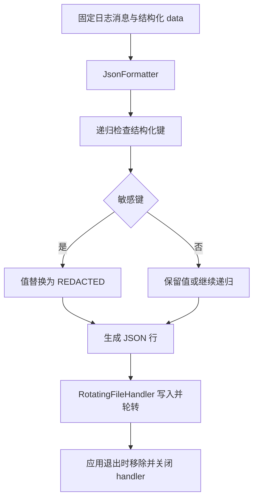

# 结构化日志、脱敏与审计

## 用途与范围

记录结构化 JSON 日志，并对指定键的值脱敏。审计日志按行追加并 `fsync`，不提供防篡改或跨进程协调。

应用选择可写日志/审计路径；只使用样例标识或已控制的消息文字。

## 模块信息

| 标识项 | 本模块信息 |
| --- | --- |
| API 命名空间 | `desktop.diagnostics` |
| Python 导入 | `ctf_desktop.diagnostics` |
| 所属发行包 | `common-tech-framework-desktop` |
| 包导入名 | `ctf_desktop` |

<span id="接入速查" class="legacy-anchor" aria-hidden="true"></span>

## 运行环境

| 环境项 | 要求 | 说明 |
| --- | --- | --- |
| Python | >=3.11 | 安装声明；不把更高版本的可安装性当作实际验证。 |
| 图形环境 | 不需要 Qt | 本模块直接运行逻辑不要求 QApplication。 |

## 依赖要求

### 运行依赖

| 依赖 | 版本 / 状态 | 使用条件 |
| --- | --- | --- |
| 第三方运行依赖 | 无 | 使用标准库；应用后端的额外依赖由应用声明。 |

### 构建依赖

| 依赖 | 声明下限 | 使用阶段 |
| --- | --- | --- |
| setuptools | >=77 | 从源码安装/构建时由 pip 隔离构建环境使用。 |
| wheel | 未声明下限 | 发行包构建依赖，不是应用运行依赖。 |

## 版本信息

| 版本项 | 当前值 / 识别方式 | 说明 |
| --- | --- | --- |
| 能力包版本 | `0.2.0` | 对应 pyproject.toml 与包版本常量。 |
| 模块版号 | 随所属包发布 | 本模块没有另行声明独立的模块版本号。 |
| 源码身份 | 网页头部的构建提交或所读 Git 版本 | 接入时记录实际安装 commit/wheel 来源；相同包版本不能代替源码身份。 |

## 兼容要求

| 兼容维度 | 本页具体要求与边界 |
| --- | --- |
| 本模块接口与升级 | JSON 日志默认5 MiB/3份历史，max_bytes=0 禁用轮转；降低历史份数不删除原有更多文件，自由文本和异常内容不自动脱敏。 |
| 接入应用兼容 | 本模块不替代应用的业务数据、权限规则或外部依赖兼容检查。 |
| 验证边界 | 依赖下限不等于所有版本组合已验证；Python/Qt、目标系统与真实设备须按实际环境确认。 |

完整历史记录可继续查阅[架构与依赖](../架构与依赖.md)和[升级与兼容](../升级与兼容.md)；本模块当前要求已在本页说明。

## 安装与导入

以下命令在本仓库根目录执行，使用当前源码安装，不假定 PyPI 已发布同名版本。

```bash
python -m pip install "./packages/python/desktop"
```

导入路径：`ctf_desktop.diagnostics`。

## 接入准备

| 应用需要提供 | 具体要求 |
| --- | --- |
| 文件位置 | 应用选择可写日志/审计路径；只使用样例标识或已控制的消息文字。 |
| 脱敏规则 | 自定义 is_sensitive 会替换默认键规则；自由文本、异常文字要在进入日志前处理。 |
| 资源管理 | 日志 handler 由应用移除并关闭；多个进程写同一审计文件需应用协调。 |

## 核心入口

| 入口 | 职责 |
| --- | --- |
| `JsonFormatter` | JSON 日志格式器，可注入结构化字段的敏感键谓词；消息文本与异常内容不会自动脱敏。 |
| `AuditEvent` | 冻结的 action、actor、resource 和 detail 字段；detail 映射不是深度冻结，应使用不含敏感内容的标识。 |
| `AuditJournal` | 在实例锁内向应用指定文件追加 JSON 并 fsync；没有跨进程锁、轮转或防篡改保证。 |
| `redact` | 递归复制映射、列表和元组，匹配敏感键的值改成 [REDACTED]；映射键转为 str，元组转列表；可替换键谓词，不清洗自由文本。 |
| `configure_json_logger` | 建立或复用同名同路径的 UTF-8 日志 handler，默认 INFO、5 MiB 阈值和 3 份历史；max_bytes=0 关闭轮转，非法限制在 IO 前拒绝，应用负责移除并关闭 handler。 |

## 日志数据流



消息文本不经过上述键脱敏，避免把敏感值拼接到消息。浏览器演示与 Python 实现都按结构化键处理，不识别自由文本隐私。

## 调用步骤

| 步骤 | 操作 |
| --- | --- |
| 1 | 约定结构化字段与敏感键 |
| 2 | 配置可写日志路径与轮转限制 |
| 3 | 用固定消息和 extra.data 记录事件 |
| 4 | 需要审计时追加 AuditEvent |
| 5 | 移除并关闭应用持有的 handlers |

## 输入签名

### 构造入口

| 入口 | 输入签名 |
| --- | --- |
| `JsonFormatter` | <code>JsonFormatter(is_sensitive: Callable[[str], bool] &#124; None=None)</code> |
| `AuditJournal` | <code>AuditJournal(path: str &#124; Path, is_sensitive=None)</code> |

### 方法

| 入口 | 输入签名 |
| --- | --- |
| `JsonFormatter.format` | `JsonFormatter.format(record: logging.LogRecord)` |
| `AuditJournal.append` | `AuditJournal.append(event: AuditEvent)` |

### 函数

| 入口 | 输入签名 |
| --- | --- |
| `redact` | <code>redact(value: Any, is_sensitive: Callable[[str], bool] &#124; None=None)</code> |
| `configure_json_logger` | <code>configure_json_logger(name: str, path: str &#124; Path, is_sensitive=None, *, level: int=logging.INFO, max_bytes: int=5 * 1024 * 1024, backup_count: int=3)</code> |

签名只列输入，返回结果另表说明；类型标注不意味着每个参数都在运行时强制校验。

## 配置字段

### AuditEvent 字段

| 字段 | 类型 | 默认值 | 含义 |
| --- | --- | --- | --- |
| `action` | `str` | 必填 | 应用定义的动作标识；授权与审计应采用稳定且不含敏感信息的值。 |
| `actor` | `str` | 必填 | 审计操作者标识，必须非空；不要在标识中嵌入口令或敏感资料。 |
| `resource` | `str` | 必填 | 应用提供的资源或资源标识，实际类型以接口声明为准。 |
| `detail` | `Mapping[str, Any]` | 必填 | 结构化审计详情映射；字段冻结不等于内部映射深度不可变。 |

冻结值对象禁止直接重新赋值字段；含映射或其他对象时，不代表内部对象被深度冻结。

## 配置参数与调用参数

### redact 输入参数

| 参数 | 声明类型 | 默认值 | 传入方式 | 含义 |
| --- | --- | --- | --- | --- |
| `value` | `Any` | 必填 | 位置或关键字 | 要处理的值；序列、映射或标量的支持范围见该接口返回说明。 |
| `is_sensitive` | <code>Callable[[str], bool] &#124; None</code> | `None` | 位置或关键字 | 敏感键谓词；None 使用默认键集合，自定义谓词替换默认规则而非自动叠加。 |

### JsonFormatter 构造参数

| 参数 | 声明类型 | 默认值 | 传入方式 | 含义 |
| --- | --- | --- | --- | --- |
| `is_sensitive` | <code>Callable[[str], bool] &#124; None</code> | `None` | 位置或关键字 | 敏感键谓词；None 使用默认键集合，自定义谓词替换默认规则而非自动叠加。 |

### JsonFormatter.format 输入参数

| 参数 | 声明类型 | 默认值 | 传入方式 | 含义 |
| --- | --- | --- | --- | --- |
| `record` | `logging.LogRecord` | 必填 | 位置或关键字 | Python logging.LogRecord；结构化字段放入 record.data，自由消息文本不会自动脱敏。 |

### configure_json_logger 输入参数

| 参数 | 声明类型 | 默认值 | 传入方式 | 含义 |
| --- | --- | --- | --- | --- |
| `name` | `str` | 必填 | 位置或关键字 | Python logger 名称；同名同路径重复配置会复用 handler。 |
| `path` | <code>str &#124; Path</code> | 必填 | 位置或关键字 | 应用选定的文件路径；读、写或目录创建行为以对应接口及资源表为准。 |
| `is_sensitive` | 未标注 | `None` | 位置或关键字 | 敏感键谓词；None 使用默认键集合，自定义谓词替换默认规则而非自动叠加。 |
| `level` | `int` | `logging.INFO` | 仅关键字 | Python logging 日志级别，默认 logging.INFO。 |
| `max_bytes` | `int` | `5 * 1024 * 1024` | 仅关键字 | 单文件轮转阈值，非负整数；0 禁止轮转，不是单条记录的长度上限。 |
| `backup_count` | `int` | `3` | 仅关键字 | 历史份数，非负整数；开启轮转时须大于0，降低此值不会删除更早的额外文件。 |

### AuditJournal 构造参数

| 参数 | 声明类型 | 默认值 | 传入方式 | 含义 |
| --- | --- | --- | --- | --- |
| `path` | <code>str &#124; Path</code> | 必填 | 位置或关键字 | 应用选定的文件路径；读、写或目录创建行为以对应接口及资源表为准。 |
| `is_sensitive` | 未标注 | `None` | 位置或关键字 | 敏感键谓词；None 使用默认键集合，自定义谓词替换默认规则而非自动叠加。 |

### AuditJournal.append 输入参数

| 参数 | 声明类型 | 默认值 | 传入方式 | 含义 |
| --- | --- | --- | --- | --- |
| `event` | `AuditEvent` | 必填 | 位置或关键字 | AuditEvent 值对象；action 和 actor 必须非空。 |

## 只读属性

本模块未额外声明 @property 只读访问器；值对象字段与调用参数分别在相应表中说明。

## 可读运行状态

| 状态 | 类型 | 读取含义 |
| --- | --- | --- |
| `AuditJournal.path` | `Path` | 审计目标路径；文件与并发策略由应用控制。 |

这些是可读取的实例状态；不把直接重新赋值当作受支持的更新接口。

## 返回值

| 接口 | 返回类型 | 返回结果 |
| --- | --- | --- |
| `redact` | `Any` | 递归复制后的结构或保留的标量；匹配键值被替换，tuple 变为 list，原输入不改变。 |
| `JsonFormatter.format` | `str` | JSON 格式字符串；本调用不会输出或写入日志文件。 |
| `configure_json_logger` | `logging.Logger` | 已配置的 logging.Logger；调用方拥有它附加的 handler 清理责任。 |
| `AuditJournal.append` | `None` | None；没有业务返回值。对应操作与失败边界分别在接口说明和错误表中列明。 |

## 信号

本模块不新增 Qt 信号。同步调用结果见返回值表；应用注入回调的输入约定见参数表。

## 错误与边界

| 触发情况 | 错误或结果 | 调用方处理 |
| --- | --- | --- |
| 非法轮转限制 | ValueError，建立 IO 前拒绝 | 使用非负整数，启用轮转时保留份数必须大于0。 |
| 日志/审计路径或 IO 失败 | 原错误上抛 | 报告写入失败，不把尝试追加说成已落盘。 |
| 敏感内容在自由文本中 | 不会自动清洗 | 在格式化前去除真实口令、身份和其他敏感文字。 |

### 错误与安全边界

| 情况 | 行为与处理 |
| --- | --- |
| 非法轮转值 | `ValueError`，在建立 handler 和文件前拒绝；`bool` 不作为整数接受 |
| IO 失败 | 文件路径、权限及审计 IO 错误由应用处理，不写成已落盘成功 |
| 自由文本 / 异常内容 | 不自动清洗；`JsonFormatter` 不输出 traceback 字段，`record.getMessage()` 中的内容仍原样进入消息 |
| 循环对象 | 不支持；先转换为有限、可序列化结构 |
| 多实例 / 多进程审计 | 不保证原子协调；同一审计文件应由应用统一所有者管理 |
| 降低历史份数 | 不删除原来更多的历史文件；由维护策略单独处理 |
| 超长单条记录 | 可超过阈值，轮转不是截断或无限空间保护 |

[公开契约与审计例子](../contracts/diagnostics.md) · [相关回归](../../tests/test_review_core.py) · [安全与数据边界](../安全与数据边界.md)

## 线程与资源

| 资源 | 拥有者 | 线程与释放要求 |
| --- | --- | --- |
| logger handler | 配置日志的应用 | finally 中 removeHandler 再 close。 |
| 审计文件 | AuditJournal 每次追加 | 实例锁协调同实例写入，追加后 flush/fsync 并关闭短期句柄。 |

## 参数与属性

- `redact(value, is_sensitive=None)`：默认键谓词；返回递归复制结果，不修改输入；mapping 键转为字符串。
- `is_sensitive(key)`：默认忽略键大小写匹配；内置键：`password`、`passwd`、`secret`、`token`、`api_key`、`authorization`；自定义谓词会替换默认规则。
- `configure_json_logger(name, path, ...)`：`level=logging.INFO`；返回 `logging.Logger`；UTF-8；创建目标父目录，关闭向上传播。
- `max_bytes`：`5 * 1024 * 1024`；非负整数；`0` 关闭轮转；不是单条日志长度上限。
- `backup_count`：`3`；非负整数；启用轮转时必须大于 0。
- `AuditEvent(action, actor, resource, detail)`：均必填；冻结字段；`detail` 不是深度不可变；标识应无敏感含义。
- `AuditJournal(path, is_sensitive=None)`：可选键谓词；同实例锁保护写入；`path` 属性为目标 Path。
- `AuditJournal.append(event)`：无返回值；校验非空 `actor/action`，写一行，flush、fsync 并关闭短期句柄。

同一 logger 名称与同一文件路径再次配置时复用 handler 并更新脱敏策略和轮转配置。自定义敏感规则要显式保留默认键，见下面例子。

## 可运行示例：脱敏、轮转与释放

```python
import json
from pathlib import Path
from tempfile import TemporaryDirectory
from ctf_desktop.diagnostics import DEFAULT_SECRET_KEYS, configure_json_logger, redact

source = {"token": "sample-only", "items": [{"name": "示例", "password": "sample-only"}]}
masked = redact(source)
assert masked["token"] == "[REDACTED]"
assert source["token"] == "sample-only"

with TemporaryDirectory() as directory:
    target = Path(directory) / "sample.jsonl"
    logger = configure_json_logger(
        "capability-guide-sample", target,
        is_sensitive=lambda key: key.lower() in DEFAULT_SECRET_KEYS or key == "contact",
        max_bytes=1024, backup_count=2,
    )
    try:
        logger.info("sample created", extra={"data": {"contact": "sample-only", "count": 1}})
        payload = json.loads(target.read_text(encoding="utf-8"))
        assert payload["data"] == {"contact": "[REDACTED]", "count": 1}
    finally:
        for handler in tuple(logger.handlers):
            logger.removeHandler(handler)
            handler.close()
```

## 验证与源码依据

实现依据：[diagnostics.py](../../src/ctf_desktop/diagnostics.py)；版本与依赖声明：[pyproject.toml](../../pyproject.toml)。

| 验证文件 | 用途 |
| --- | --- |
| [test_contracts.py](../../tests/test_contracts.py) | 源码标注的契约或回归入口；按改动范围选用。 |
| [test_core.py](../../tests/test_core.py) | 源码标注的契约或回归入口；按改动范围选用。 |
| [test_review_core.py](../../tests/test_review_core.py) | 源码标注的契约或回归入口；按改动范围选用。 |

在已按本页安装依赖的仓库根目录运行：

```bash
python packages/python/desktop/examples/check_contract_examples.py
```

示例检查只执行本仓库文档代码；pytest 回归另需 test extra（pytest>=8），Qt 回归还需 qt extra。浏览器 mock、离屏示例与真实 GUI/设备验收是不同验证范围。
