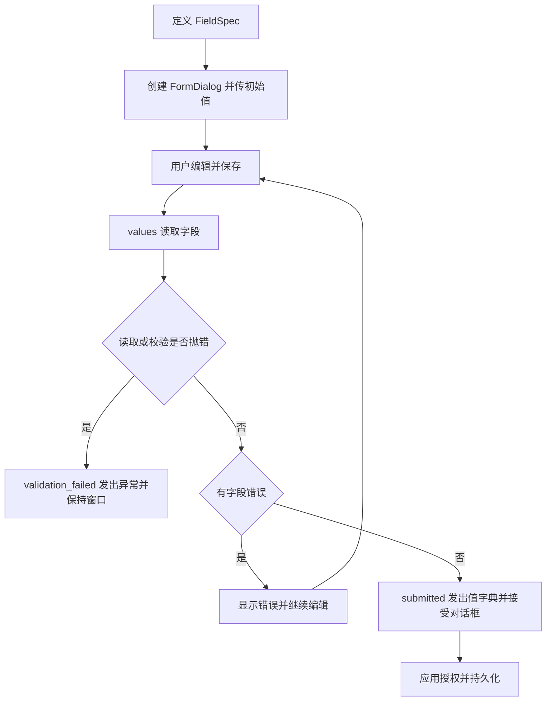

# 表单与只读详情

用字段描述生成本地编辑对话框，校验通过后交付值字典。持久化、授权和服务端校验由应用处理。

## 接入速查

| 项目 | 要求 / 行为 |
| --- | --- |
| 运行环境 | Python >= 3.11；`qt` extra，PyQt5 >= 5.15；`QApplication` |
| 导入 | `FieldSpec`、`FormDialog`、`DetailView`、`validate_values` 来自 `ctf_desktop.forms` |
| 输入 / 输出 | 字段配置与初始值字典 → `submitted(dict)` |
| 校验 | 必填 → 字段校验函数；失败保持窗口打开 |
| 生命周期 | Qt 线程创建和使用；取消不写数据；独立对话框用完后 `close` / `deleteLater` |
| 版本 / 兼容 | [环境与依赖](../架构与依赖.md) · [升级与兼容](../升级与兼容.md) |

## 提交流程



## FieldSpec 属性

| 属性 | 类型 / 默认值 | 说明 |
| --- | --- | --- |
| `key` | `str`，必填 | 值字典中的字段名；对话框内非空且唯一 |
| `label` | `str`，必填 | 界面标签 |
| `kind` | `str`，默认 `"text"` | 允许 `text`、`multiline`、`integer`、`boolean`、`choice`、`custom` |
| `required` | `bool`，默认 `False` | `None` 与空字符串视为缺失；`0` 和 `False` 合法 |
| `choices` | tuple，默认 `()` | 每项 `(真实值, 显示文字)`；返回真实值，非必填可选空项 |
| `validate` | callable / `None`，默认 `None` | 接收字段值，返回错误文字或 `None`；不做持久化 |
| `widget_factory` | callable / `None` | `custom` 必填；接收初始值并返回 QWidget |
| `value_reader` | callable / `None` | `custom` 必填；读取自定义 QWidget 的当前值 |

`FieldSpec` 是冻结 dataclass，修改配置时构造新对象。`integer` 使用 Qt 32 位有符号范围；`text` 取值去除两端空白，`multiline` 保留内容，`choice` 返回 data。

## 方法与事件

| 接口 / 信号 | 输入或载荷 | 结果 / 约束 |
| --- | --- | --- |
| `FormDialog(title, fields, initial=None, parent=None)` | 标题、字段序列、初始值映射 | 构造重复 / 空字段键时 `ValueError` |
| `values()` | 无 | 新值字典；自定义 reader 的异常上抛 |
| `submitted` | `dict` | 字段读取及校验成功后发出；随后 `accept()` |
| `validation_failed` | 异常对象 | 读取 / 自定义校验抛错时发出；窗口保持打开 |
| `validate_values(fields, values)` | 字段和候选值 | 返回 `{字段键: 错误文字}`，不写数据 |
| `DetailView(fields, values, parent=None)` | 字段与值 | 只读标签；`None` 显示为空，其余转字符串 |

普通字段校验失败显示在对话框内，不发送 `validation_failed`；该信号只报告异常路径。`submitted` 只表示本地校验通过，不能当作数据库提交成功。

## 可运行示例：必填与类型保持

```python
from PyQt5.QtWidgets import QApplication
from ctf_desktop.forms import FieldSpec, FormDialog, validate_values

app = QApplication.instance() or QApplication([])
fields = [
    FieldSpec("name", "名称", required=True),
    FieldSpec("copies", "份数", kind="integer", required=True,
              validate=lambda value: "份数不能为负" if value < 0 else None),
    FieldSpec("enabled", "启用", kind="boolean", required=True),
    FieldSpec("mode", "模式", kind="choice", choices=(("draft", "草稿"), ("ready", "就绪"))),
]
assert validate_values(fields, {"name": "", "copies": 0, "enabled": False}) == {"name": "必填"}
dialog = FormDialog("编辑示例", fields, {"name": "样例", "copies": 0, "enabled": False})
try:
    values = dialog.values()
    assert values["copies"] == 0
    assert values["enabled"] is False
    assert validate_values(fields, values) == {}
    # 真实应用：dialog.submitted.connect(你的授权与保存入口)，然后显示窗口。
finally:
    dialog.close()
    dialog.deleteLater()
```

## 错误、扩展与边界

不支持的 `kind`、缺少自定义工厂 / reader 属于配置错误，构造时失败。校验回调只返回用户可读错误或 `None`；异常交给 `validation_failed` 记录。服务端写入前仍应再次验证权限与数据。

组件没有跨字段依赖引擎或持久化；自定义控件资源由 Qt 父子关系和应用清理代码管理。不要在校验回调中阻塞 GUI 或执行写入。

[完整契约与最小例子](../contracts/forms.md) · [交互桌面示例](../../examples/qt_showcase.py) · [相关测试](../../tests/test_review_qt.py)
