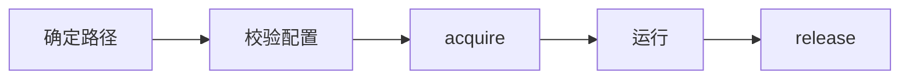

# 目录配置与单实例

<span id="适用场景" class="legacy-anchor" aria-hidden="true"></span>

## 用途与范围

桌面应用读取用户配置、确定数据目录、防止重复启动。

AppPaths.app_id 必须是安全路径片段；SingleInstance 使用稳定非空标识。

## 模块信息

| 标识项 | 本模块信息 |
| --- | --- |
| API 命名空间 | `desktop.runtime` |
| Python 导入 | `ctf_desktop.runtime` |
| 所属发行包 | `common-tech-framework-desktop` |
| 包导入名 | `ctf_desktop` |

<span id="接入速查" class="legacy-anchor" aria-hidden="true"></span>

## 运行环境

| 环境项 | 要求 | 说明 |
| --- | --- | --- |
| Python | >=3.11 | 安装声明；不把更高版本的可安装性当作实际验证。 |
| 目录与 JSON | 无图形环境要求 | 仅使用 AppPaths/load_json_config 不需 Qt。 |
| 单实例 | Qt 事件环境 | 仅 SingleInstance.acquire 路径加载 QtNetwork。 |

## 依赖要求

### 运行依赖

| 依赖 | 版本 / 状态 | 使用条件 |
| --- | --- | --- |
| PyQt5 | >=5.15（按需） | 只有 SingleInstance.acquire 需要 qt extra，路径/JSON 功能不需要。 |

### 构建依赖

| 依赖 | 声明下限 | 使用阶段 |
| --- | --- | --- |
| setuptools | >=77 | 从源码安装/构建时由 pip 隔离构建环境使用。 |
| wheel | 未声明下限 | 发行包构建依赖，不是应用运行依赖。 |

## 版本信息

| 版本项 | 当前值 / 识别方式 | 说明 |
| --- | --- | --- |
| 能力包版本 | `0.2.0` | 对应 pyproject.toml 与包版本常量。 |
| 模块版号 | 随所属包发布 | 本模块没有另行声明独立的模块版本号。 |
| 源码身份 | 网页头部的构建提交或所读 Git 版本 | 接入时记录实际安装 commit/wheel 来源；相同包版本不能代替源码身份。 |

## 兼容要求

| 兼容维度 | 本页具体要求与边界 |
| --- | --- |
| 本模块接口与升级 | 目录规则取决于平台环境变量，计算路径不创建目录；单实例基于 Qt 本地 socket，不提供远程分布式锁或进程强杀。 |
| 接入应用兼容 | 本模块不替代应用的业务数据、权限规则或外部依赖兼容检查。 |
| 验证边界 | 依赖下限不等于所有版本组合已验证；Python/Qt、目标系统与真实设备须按实际环境确认。 |

完整历史记录可继续查阅[架构与依赖](../架构与依赖.md)和[升级与兼容](../升级与兼容.md)；本模块当前要求已在本页说明。

## 安装与导入

以下命令在本仓库根目录执行，使用当前源码安装，不假定 PyPI 已发布同名版本。 路径/JSON 功能使用基础包；使用单实例时将安装目标改成 "./packages/python/desktop[qt]"。

```bash
python -m pip install "./packages/python/desktop"
```

导入路径：`ctf_desktop.runtime`。

## 接入准备

| 应用需要提供 | 具体要求 |
| --- | --- |
| 应用标识 | AppPaths.app_id 必须是安全路径片段；SingleInstance 使用稳定非空标识。 |
| 配置校验 | load_json_config 必须注入 validate，校验失败抛错，不自动覆盖原文件。 |
| 单实例环境 | 仅 acquire 路径需要 PyQt5 QtNetwork 与 Qt 事件环境；应用退出时 release。 |

## 核心入口

| 入口 | 职责 |
| --- | --- |
| `AppPaths` | 冻结的安全 app_id 路径片段，拒绝点路径和非法字符；只有 ensure_user_data 才创建目录。 |
| `SingleInstance` | 按应用 app_id 使用 Qt 本地 server 进行单实例守卫；拒绝空 ID，依赖 Qt 事件环境，由调用方 release。 |
| `load_json_config` | 读取 UTF-8 JSON 对象并调用必需校验器，返回 dict；JSON、IO 和校验异常上抛，不写文件。 |

## 接入流程



## 调用步骤

| 步骤 | 操作 |
| --- | --- |
| 1 | 确定路径 |
| 2 | 校验配置 |
| 3 | acquire |
| 4 | 运行 |
| 5 | release |

## 输入签名

### 构造入口

| 入口 | 输入签名 |
| --- | --- |
| `SingleInstance` | `SingleInstance(app_id: str)` |

### 方法

| 入口 | 输入签名 |
| --- | --- |
| `AppPaths.user_data` | `AppPaths.user_data()` |
| `AppPaths.ensure_user_data` | `AppPaths.ensure_user_data()` |
| `SingleInstance.acquire` | `SingleInstance.acquire()` |
| `SingleInstance.release` | `SingleInstance.release()` |

### 函数

| 入口 | 输入签名 |
| --- | --- |
| `load_json_config` | <code>load_json_config(path: str &#124; Path, validate: Callable[[Mapping[str, Any]], None])</code> |

签名只列输入，返回结果另表说明；类型标注不意味着每个参数都在运行时强制校验。

## 配置字段

### AppPaths 字段

| 字段 | 类型 | 默认值 | 含义 |
| --- | --- | --- | --- |
| `app_id` | `str` | 必填 | 应用标识；AppPaths 要求安全的单路径片段，SingleInstance 要求稳定非空 ID。 |

冻结值对象禁止直接重新赋值字段；含映射或其他对象时，不代表内部对象被深度冻结。

## 配置参数与调用参数

### load_json_config 输入参数

| 参数 | 声明类型 | 默认值 | 传入方式 | 含义 |
| --- | --- | --- | --- | --- |
| `path` | <code>str &#124; Path</code> | 必填 | 位置或关键字 | 应用选定的文件路径；读、写或目录创建行为以对应接口及资源表为准。 |
| `validate` | `Callable[[Mapping[str, Any]], None]` | 必填 | 位置或关键字 | 必需的 validate(mapping)，合法时返回，非法时抛错；不会覆盖配置文件。 |

### SingleInstance 构造参数

| 参数 | 声明类型 | 默认值 | 传入方式 | 含义 |
| --- | --- | --- | --- | --- |
| `app_id` | `str` | 必填 | 位置或关键字 | 应用标识；AppPaths 要求安全的单路径片段，SingleInstance 要求稳定非空 ID。 |

## 只读属性

本模块未额外声明 @property 只读访问器；值对象字段与调用参数分别在相应表中说明。

## 返回值

| 接口 | 返回类型 | 返回结果 |
| --- | --- | --- |
| `AppPaths.user_data` | `Path` | 平台用户数据目录 Path；仅计算，不创建目录。 |
| `AppPaths.ensure_user_data` | `Path` | 已创建或已存在的用户数据目录 Path。 |
| `load_json_config` | `dict[str, Any]` | 已通过应用校验的 JSON 对象 dict；不写回文件。 |
| `SingleInstance.acquire` | `bool` | 取得或已经持有自己的监听为 True；检测到活动同伴为 False。 |
| `SingleInstance.release` | `None` | None；没有业务返回值。对应操作与失败边界分别在接口说明和错误表中列明。 |

## 信号

本模块不新增 Qt 信号。同步调用结果见返回值表；应用注入回调的输入约定见参数表。

## 错误与边界

| 触发情况 | 错误或结果 | 调用方处理 |
| --- | --- | --- |
| 非法 app_id | ValueError | 不要使用点路径或不安全字符。 |
| JSON/IO/业务校验失败 | 原异常上抛 | 保留原文件并明确提示，不自动覆盖。 |
| 单实例仍无法监听 | RuntimeError；活动同伴为 False | 区分活动实例和监听错误，不结束其他进程。 |

### 失败与边界

JSON 根必须是对象，文件或校验错误上抛。单实例获取成功返回 true，存在可连接对端返回 false；监听失败抛 RuntimeError。

单实例是本地入口守卫，不是授权或分布式锁；不能用它替代数据库写入协调。应用 ID 的变更可能改变数据目录和 socket 身份。

## 线程与资源

| 资源 | 拥有者 | 线程与释放要求 |
| --- | --- | --- |
| 目录与配置文件 | 应用 | 路径计算不创建目录；JSON 读取不写文件。 |
| 本地单实例监听 | SingleInstance | Qt 环境中 acquire，退出时 release，不终止同伴进程。 |

无 Qt 模块可单独安装。单实例需要 Qt 环境，退出时 finally release；不终止其他进程。

## 接口与接入

AppPaths 计算平台目录，ensure 才创建；load_json_config 读取对象后调用应用校验；SingleInstance 使用 Qt 本地 server 名。

用稳定、安全 app_id；配置校验器对非法内容抛异常；同一进程长期保留 SingleInstance 对象直到退出。

<span id="示例与验证" class="legacy-anchor" aria-hidden="true"></span>

## 最小调用示例

```python
import json
from pathlib import Path
from tempfile import TemporaryDirectory
from ctf_desktop.runtime import AppPaths, load_json_config

# user_data 只计算目录，不在真实用户目录中创建文件。
assert AppPaths("sample-app").user_data().name == "sample-app"
def validate(values):
    if not isinstance(values.get("enabled"), bool):
        raise ValueError("enabled must be boolean")
with TemporaryDirectory() as directory:
    path = Path(directory) / "config.json"
    path.write_text(json.dumps({"enabled": True}), encoding="utf-8")
    assert load_json_config(path, validate) == {"enabled": True}
```

## 验证与源码依据

实现依据：[runtime.py](../../src/ctf_desktop/runtime.py)；版本与依赖声明：[pyproject.toml](../../pyproject.toml)。

| 验证文件 | 用途 |
| --- | --- |
| [test_contracts.py](../../tests/test_contracts.py) | 源码标注的契约或回归入口；按改动范围选用。 |
| [test_core.py](../../tests/test_core.py) | 源码标注的契约或回归入口；按改动范围选用。 |
| [test_review_core.py](../../tests/test_review_core.py) | 源码标注的契约或回归入口；按改动范围选用。 |

在已按本页安装依赖的仓库根目录运行：

```bash
python packages/python/desktop/examples/check_contract_examples.py
```

示例检查只执行本仓库文档代码；pytest 回归另需 test extra（pytest>=8），Qt 回归还需 qt extra。浏览器 mock、离屏示例与真实 GUI/设备验收是不同验证范围。
