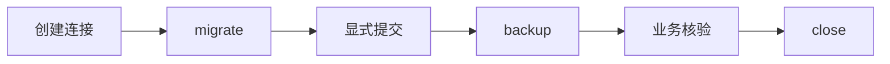

# SQLite 迁移备份恢复

<span id="适用场景" class="legacy-anchor" aria-hidden="true"></span>

## 用途与范围

单进程本地软件管理一个标准明文 SQLite 文件。

提供唯一正整数版本和迁移回调；回调不 commit、不 executescript、不自行管理事务。

## 模块信息

| 标识项 | 本模块信息 |
| --- | --- |
| API 命名空间 | `desktop.storage` |
| Python 导入 | `ctf_desktop.storage` |
| 所属发行包 | `common-tech-framework-desktop` |
| 包导入名 | `ctf_desktop` |

<span id="接入速查" class="legacy-anchor" aria-hidden="true"></span>

## 运行环境

| 环境项 | 要求 | 说明 |
| --- | --- | --- |
| Python | >=3.11 | 安装声明；不把更高版本的可安装性当作实际验证。 |
| 图形环境 | 不需要 Qt | 本模块直接运行逻辑不要求 QApplication。 |

## 依赖要求

### 运行依赖

| 依赖 | 版本 / 状态 | 使用条件 |
| --- | --- | --- |
| 第三方运行依赖 | 无 | 使用标准库；应用后端的额外依赖由应用声明。 |

### 构建依赖

| 依赖 | 声明下限 | 使用阶段 |
| --- | --- | --- |
| setuptools | >=77 | 从源码安装/构建时由 pip 隔离构建环境使用。 |
| wheel | 未声明下限 | 发行包构建依赖，不是应用运行依赖。 |

## 版本信息

| 版本项 | 当前值 / 识别方式 | 说明 |
| --- | --- | --- |
| 能力包版本 | `0.2.0` | 对应 pyproject.toml 与包版本常量。 |
| 模块版号 | 随所属包发布 | 本模块没有另行声明独立的模块版本号。 |
| 源码身份 | 网页头部的构建提交或所读 Git 版本 | 接入时记录实际安装 commit/wheel 来源；相同包版本不能代替源码身份。 |

## 兼容要求

| 兼容维度 | 本页具体要求与边界 |
| --- | --- |
| 本模块接口与升级 | 包版本与 PRAGMA user_version 不同；不提供反向迁移、SQLCipher 或密钥管理。非空迁移列表可拒绝高于其上限的 schema，空列表不是未来版本检测器。 |
| 业务数据兼容 | 业务 schema 与降级由应用迁移策略定义；整库加密和密钥兼容不在本模块实现中。 |
| 验证边界 | 依赖下限不等于所有版本组合已验证；Python/Qt、目标系统与真实设备须按实际环境确认。 |

完整历史记录可继续查阅[架构与依赖](../架构与依赖.md)和[升级与兼容](../升级与兼容.md)；本模块当前要求已在本页说明。

## 安装与导入

以下命令在本仓库根目录执行，使用当前源码安装，不假定 PyPI 已发布同名版本。

```bash
python -m pip install "./packages/python/desktop"
```

导入路径：`ctf_desktop.storage`。

## 接入准备

| 应用需要提供 | 具体要求 |
| --- | --- |
| 迁移定义 | 提供唯一正整数版本和迁移回调；回调不 commit、不 executescript、不自行管理事务。 |
| 目录条件 | 目标目录可写；备份目标文件系统须支持硬链接，且目标文件不存在；源数据库可位于其他文件系统。 |
| 恢复窗口 | 恢复前停止其他写入并关闭外部连接；应用负责业务核验、密钥和降级方案。 |

## 核心入口

| 入口 | 职责 |
| --- | --- |
| `Migration` | 冻结的正整数版本及 SQLite 迁移回调，不接受 bool 版本；回调不能 commit、executescript 或自行管理事务，非法配置抛 ValueError。 |
| `SqliteStore` | 拥有一个同线程的明文 SQLite 连接并创建所需父目录；with 连接并始终关闭，但不隐式提交业务写入，没有 SQLCipher 或密钥管理。 |

## 接入流程



## 调用步骤

| 步骤 | 操作 |
| --- | --- |
| 1 | 创建连接 |
| 2 | migrate |
| 3 | 显式提交 |
| 4 | backup |
| 5 | 业务核验 |
| 6 | close |

## 输入签名

### 构造入口

| 入口 | 输入签名 |
| --- | --- |
| `SqliteStore` | <code>SqliteStore(path: str &#124; Path)</code> |

### 方法

| 入口 | 输入签名 |
| --- | --- |
| `SqliteStore.connect` | `SqliteStore.connect()` |
| `SqliteStore.close` | `SqliteStore.close()` |
| `SqliteStore.migrate` | `SqliteStore.migrate(migrations: Iterable[Migration])` |
| `SqliteStore.backup` | <code>SqliteStore.backup(destination: str &#124; Path)</code> |
| `SqliteStore.restore` | <code>SqliteStore.restore(source: str &#124; Path)</code> |

签名只列输入，返回结果另表说明；类型标注不意味着每个参数都在运行时强制校验。

## 配置字段

### Migration 字段

| 字段 | 类型 | 默认值 | 含义 |
| --- | --- | --- | --- |
| `version` | `int` | 必填 | 业务数据库迁移版本，正整数且不接受 bool；不是能力包版本。 |
| `apply` | `Callable[[sqlite3.Connection], None]` | 必填 | apply(sqlite_connection) 迁移回调，不得 commit、executescript 或接管事务。 |

冻结值对象禁止直接重新赋值字段；含映射或其他对象时，不代表内部对象被深度冻结。

## 配置参数与调用参数

### SqliteStore 构造参数

| 参数 | 声明类型 | 默认值 | 传入方式 | 含义 |
| --- | --- | --- | --- | --- |
| `path` | <code>str &#124; Path</code> | 必填 | 位置或关键字 | 应用选定的文件路径；读、写或目录创建行为以对应接口及资源表为准。 |

### SqliteStore.migrate 输入参数

| 参数 | 声明类型 | 默认值 | 传入方式 | 含义 |
| --- | --- | --- | --- | --- |
| `migrations` | `Iterable[Migration]` | 必填 | 位置或关键字 | 应用定义的 Migration 序列，版本必须唯一且为正整数，回调不得自行提交事务。 |

### SqliteStore.backup 输入参数

| 参数 | 声明类型 | 默认值 | 传入方式 | 含义 |
| --- | --- | --- | --- | --- |
| `destination` | <code>str &#124; Path</code> | 必填 | 位置或关键字 | 尚不存在的备份目标，不得为当前库；发布要求同文件系统硬链接。 |

### SqliteStore.restore 输入参数

| 参数 | 声明类型 | 默认值 | 传入方式 | 含义 |
| --- | --- | --- | --- | --- |
| `source` | <code>str &#124; Path</code> | 必填 | 位置或关键字 | 不同且有效的 SQLite 恢复源；应用先停止其他写入和连接。 |

## 只读属性

本模块未额外声明 @property 只读访问器；值对象字段与调用参数分别在相应表中说明。

## 返回值

| 接口 | 返回类型 | 返回结果 |
| --- | --- | --- |
| `SqliteStore.connect` | `sqlite3.Connection` | 已启用 foreign_keys 的自有 SQLite 连接；后续调用复用它。 |
| `SqliteStore.close` | `None` | None；没有业务返回值。对应操作与失败边界分别在接口说明和错误表中列明。 |
| `SqliteStore.migrate` | `int` | 成功迁移后的 PRAGMA user_version 整数，未升级时为当前版本。 |
| `SqliteStore.backup` | `Path` | 成功发布的新快照 Path；不会返回一个被覆盖的旧快照。 |
| `SqliteStore.restore` | <code>Path &#124; None</code> | 已有数据库的回滚快照 Path；没有原数据库时可为 None。 |

## 信号

本模块不新增 Qt 信号。同步调用结果见返回值表；应用注入回调的输入约定见参数表。

## 错误与边界

| 触发情况 | 错误或结果 | 调用方处理 |
| --- | --- | --- |
| 迁移版本/回调非法或执行失败 | 校验失败或原异常；事务回滚 | 保留旧库副本并修正迁移，不删库绕过。 |
| 目标已存在、待提交写入或不支持硬链接 | 备份失败 | 显式提交/回滚并选择新的同文件系统目标，不覆盖旧快照。 |
| 恢复源无效或替换失败 | 错误上抛，尽力恢复并保留回滚材料 | 停写、关闭外部连接并核验业务数据。 |

### 失败与边界

迁移版本必须是正整数，排除 bool；重复启动跳过已完成版本；失败整体回滚。备份经检查后以硬链接无覆盖发布，目标被并发占用时失败；不支持硬链接的文件系统会明确报错。

没有 SQLCipher、字段密钥、跨进程锁或断电后的多文件恢复。restore 返回旧库回滚快照，不自动验证患者/订单等业务内容，也不支持任意降级。

## 线程与资源

迁移前应先处理应用已有的待提交写入。参数校验或开启事务之前的失败不会替应用回滚业务写入；回调必须遵守不自行提交或管理事务的契约。

| 资源 | 拥有者 | 线程与释放要求 |
| --- | --- | --- |
| SQLite 连接 | SqliteStore | 只在拥有者线程使用，finally close 或 with；业务写入显式提交。 |
| 快照与回滚文件 | 应用 | 核验后按保留策略清理；恢复期间其他连接必须由应用停止。 |

同一连接遵守 sqlite3 同线程约束；close 不提交未提交写入。备份和恢复的临时连接显式关闭，暂存文件在异常时删除。

## 接口与接入

Migration 描述版本与回调；SqliteStore 持有同线程连接，提供 migrate、backup、restore。

迁移回调只执行语句，不自行 commit/executescript；先显式提交或回滚，再 backup。恢复前停止其他写入并关闭所有外部连接。

<span id="示例与验证" class="legacy-anchor" aria-hidden="true"></span>

## 最小调用示例

示例使用虚构数据和临时资源，不连接真实设备或业务存储。

```python
from pathlib import Path
from tempfile import TemporaryDirectory
from ctf_desktop.storage import Migration, SqliteStore
with TemporaryDirectory() as directory:
    store = SqliteStore(Path(directory) / "sample.sqlite")
    try:
        assert store.migrate([Migration(1, lambda db: db.execute("CREATE TABLE items (id INTEGER)"))]) == 1
        assert store.backup(Path(directory) / "snapshot.sqlite").is_file()
    finally:
        store.close()
```

## 验证与源码依据

实现依据：[storage.py](../../src/ctf_desktop/storage.py)；版本与依赖声明：[pyproject.toml](../../pyproject.toml)。

| 验证文件 | 用途 |
| --- | --- |
| [test_contracts.py](../../tests/test_contracts.py) | 源码标注的契约或回归入口；按改动范围选用。 |
| [test_core.py](../../tests/test_core.py) | 源码标注的契约或回归入口；按改动范围选用。 |
| [test_review_core.py](../../tests/test_review_core.py) | 源码标注的契约或回归入口；按改动范围选用。 |

在已按本页安装依赖的仓库根目录运行：

```bash
python packages/python/desktop/examples/check_contract_examples.py
```

示例检查只执行本仓库文档代码；pytest 回归另需 test extra（pytest>=8），Qt 回归还需 qt extra。浏览器 mock、离屏示例与真实 GUI/设备验收是不同验证范围。
