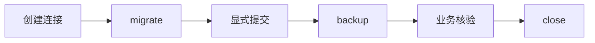

# SQLite 迁移备份恢复

## 接入速查

| 接入项 | 要求 / 用法 |
| --- | --- |
| 环境与依赖 | 标准库 sqlite3；连接限同线程；明文库 |
| 核心入口 | `Migration` / `SqliteStore` |
| 调用顺序 | 创建连接 → migrate → 显式提交 → backup → 业务核验 → close |
| 关键边界 | 失败回滚；恢复前停写与关闭外部连接；不提供业务降级或加密 |
| 方法 / 属性 | `connect`, `migrate`, `backup`, `restore`, `close` |
| 版本与兼容 | [依赖说明](../架构与依赖.md) · [升级说明](../升级与兼容.md) |

## 接入流程

## 适用场景

单进程本地软件管理一个标准明文 SQLite 文件。

## 接口与接入

Migration 描述版本与回调；SqliteStore 持有同线程连接，提供 migrate、backup、restore。

迁移回调只执行语句，不自行 commit/executescript；先显式提交或回滚，再 backup。恢复前停止其他写入并关闭所有外部连接。

## 失败与边界

迁移版本必须是正整数，排除 bool；重复启动跳过已完成版本；失败整体回滚。备份经检查后以硬链接无覆盖发布，目标被并发占用时失败；不支持硬链接的文件系统会明确报错。

没有 SQLCipher、字段密钥、跨进程锁或断电后的多文件恢复。restore 返回旧库回滚快照，不自动验证患者/订单等业务内容，也不支持任意降级。

## 线程与资源

同一连接遵守 sqlite3 同线程约束；close 不提交未提交写入。备份和恢复的临时连接显式关闭，暂存文件在异常时删除。

## 示例与验证

- [最小调用与公开契约](../contracts/storage.md)。每个模块的最小例子均由 `python examples/check_contract_examples.py` 执行；Qt 模块追加 `--qt`。
- [异常与恢复场景](../../examples/failure_scenarios.py)；[可交互桌面示例](../../examples/qt_showcase.py)。
- 验证入口：`tests/test_core.py、tests/test_contracts.py、tests/test_review_core.py`。

保留回滚文件直到应用业务核验完成，勿在现场数据库上试验新迁移。
