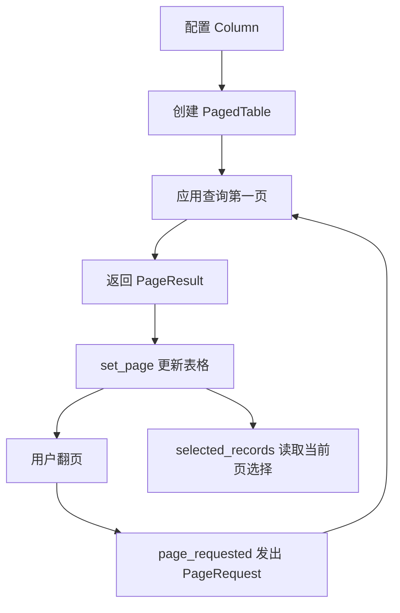

# 数据表格与分页

把分页请求交给应用的数据层，再将结果显示为可选择的表格。组件只管理展示与当前页选择，业务查询由应用提供。

## 接入速查

| 项目 | 要求 / 行为 |
| --- | --- |
| 运行环境 | Python >= 3.11；`qt` extra，PyQt5 >= 5.15；需要 `QApplication` |
| 导入 | `ctf_desktop.table`；分页值对象来自 `ctf_desktop.query` |
| 首次显示 | 主动调用 `set_page(PageResult(...))`，构造表格不会自动查询 |
| 翻页 | 连接 `page_requested(PageRequest)`，查询完成后再次 `set_page` |
| 线程 | 构造、信号回调、更新和选择读取在 Qt 线程；慢查询另行调度 |
| 状态重置 | `set_page` 重置当前选择；不保留跨页选中项 |
| 版本 / 兼容 | [环境与依赖](../架构与依赖.md) · [升级与兼容](../升级与兼容.md) |

## 数据流



## 配置、属性与事件

| 对象 / 参数 | 类型与默认值 | 用法与限制 |
| --- | --- | --- |
| `Column.key` | `str`，必填 | 对应记录字典的键；列集合非空且键唯一 |
| `Column.title` | `str`，必填 | 表头文案；不作为 SQL 字段表达式 |
| `Column.display` | `Callable`，默认 `str` | 接收单元格值并返回文字；应快速、无副作用且不抛错；`None` 直接显示为空 |
| `PagedTable.page_size` | 构造参数，默认 `20` | 正整数，传入 `PageRequest` 验证；`True` 不合法 |
| `PagedTable.request` | `PageRequest` | 当前已显示页的请求；每次 `set_page` 更新 |
| `PagedTable.model` | `RecordTableModel` | 持有列定义与记录浅拷贝；嵌套对象不会深拷贝 |
| `page_requested` | 信号，载荷 `PageRequest` | 包含目标页号与每页数量；组件不访问数据库 |
| `set_page(page)` | 输入 `PageResult`；返回 `None` | 显示数据和总数，更新上一页 / 下一页按钮 |
| `selected_records()` | 返回 `tuple[Mapping, ...]` | 按当前显示行顺序返回；未选择时为空 tuple |

完整 Qt 模型方法及分页对象参数见 [表格契约](../contracts/table.md) 与 [查询契约](../contracts/query.md)。

## 可运行示例：接入内存分页

在已安装桌面包及 `qt` 依赖的环境中运行。示例不访问外部数据，退出前关闭控件。

```python
from PyQt5.QtWidgets import QApplication
from ctf_desktop.query import PageRequest, PageResult
from ctf_desktop.table import Column, PagedTable

app = QApplication.instance() or QApplication([])
records = tuple({"name": f"示例 {number}"} for number in range(1, 6))
widget = PagedTable([Column("name", "名称")], page_size=2)

def load(request):
    rows = records[request.offset:request.offset + request.size]
    widget.set_page(PageResult(rows, len(records), request))

widget.page_requested.connect(load)
try:
    load(PageRequest(1, 2))
    assert widget.model.rowCount() == 2
    assert widget.request.number == 1
    assert widget.selected_records() == ()
    # 在真实窗口中，用户点击下一页也会经过这个 load 回调。
    widget.page_requested.emit(PageRequest(2, 2))
    assert widget.model.records[0]["name"] == "示例 3"
finally:
    widget.close()
    widget.deleteLater()
```

## 错误与边界

| 情况 | 组件行为 | 应用应处理 |
| --- | --- | --- |
| 空列 / 重复列键 | 构造时 `ValueError` | 启动时核验字段配置 |
| 空数据 | 显示总数 0、至少 1 页；禁止不可用导航 | 用相同条件计算行集与总数 |
| 非法记录在转换时失败 | 既有模型数据不变，不遗留 reset 状态 | 记录查询失败；不要展示为成功空结果 |
| 总数 / 页码与行集不一致 | 不自动修正业务结果 | 仓储返回一致的 `PageResult` |
| 选择跨页或刷新 | 原选择重置 | 批量操作明确选择范围，并按主键重新授权 |
| 展示回调抛错 | 错误上抛 | 先验证格式化逻辑，不在回调中做慢 IO |

没有自动筛选、持久化排序或跨页全选。大型结果应分页；后台线程查询完成后，通过信号回到 Qt 线程更新。

## 示例与验证入口

[交互桌面示例](../../examples/qt_showcase.py) · [最小契约示例](../contracts/table.md) · [测试](../../tests/test_qt_contracts.py)。契约示例由 `examples/check_contract_examples.py --qt` 执行；这里的浏览器展示只演示交互，不代替 Qt 目标环境验收。
