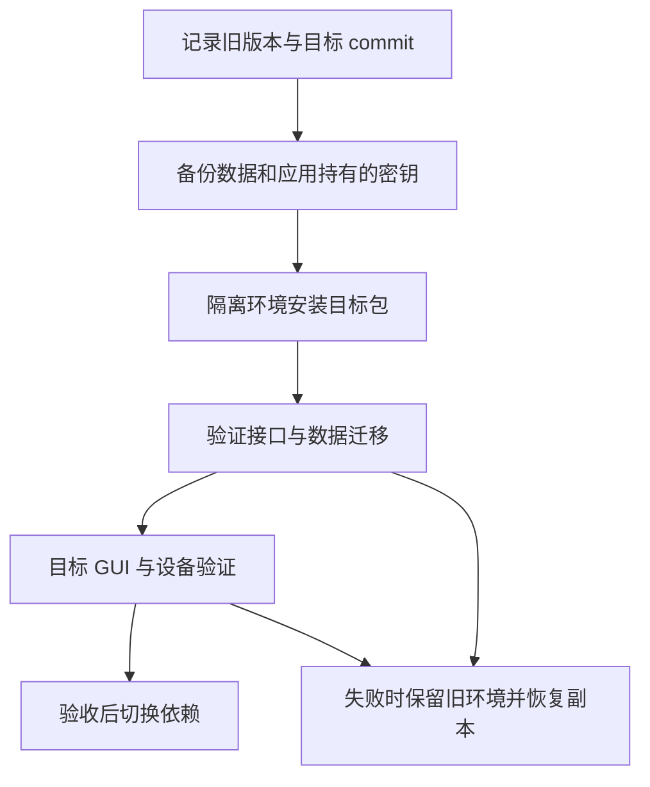

# 升级与兼容

接口基线为 [pyproject.toml](../pyproject.toml) 中的 `0.2.0`。包版本不代替提交身份；部署时固定实际审阅的 commit 或 wheel，阅读与它一致的文档。依赖的声明下限见 [架构与依赖](架构与依赖.md)。

## 声明与验证矩阵

下表区分安装声明、已留存的测试证据与接入应用仍需执行的检查，不将历史结果视为本次提交重跑通过。

| 环境 / 能力 | 声明或实现条件 | 已有证据 | 未覆盖范围 |
| --- | --- | --- | --- |
| Python | `>=3.11` | 2026-10-20 本地 Python 3.11.15；CI 配置 Python 3.11 | 3.12 及更高版本没有本页可引用的验证记录 |
| Qt 组件 | PyQt5 `>=5.15`，Qt 事件线程与事件循环 | 历史 macOS arm64，PyQt5 5.15.11 / Qt 5.15.19，离屏测试 | PyQt6、PySide、不同行为的 Qt 组合、目标系统真实窗口 |
| macOS | 取决于所用 Python、Qt、驱动与系统资源 | 历史 arm64 独立 wheel 与离屏验证 | 不推定 Intel、其他系统版本或签名安装包 |
| Linux | CI 使用 `ubuntu-latest` 和 offscreen | [工作流](../../../../.github/workflows/desktop.yml) 配置 `test` / `all` 两组检查 | 工作流配置不是某次执行成功证据；桌面会话、发行版与打印驱动需另验 |
| Windows | 包没有专用平台限制；实际依赖需能安装 | 提供 PowerShell 安装方式 | 没有 Windows 实机 GUI、设备或安装包验收证据 |
| 无界面核心 | 基础依赖为空，不需要 Qt / pyserial | 历史独立 wheel 核心环境 69 项测试通过 | 新提交仍需按改动运行相应检查 |
| 完整包 | `all` extras；Qt 测试可用 offscreen | 历史独立 wheel 104 项；后续 editable 源码 108 项 | 后一源码结果不替代前一 wheel 或当前提交的构建验收 |
| 真实串口 / 打印机 | pyserial、系统权限或驱动、应用后端 | 注入工厂和模拟打印的契约测试 | 真实设备、实际协议、脱机与驱动环境 |
| SQLite | 标准库 `sqlite3`、可写目录；备份需硬链接 | 迁移、备份、恢复和异常清理的契约测试 | 业务 schema、SQLCipher、密钥管理、多进程业务一致性 |

历史环境、命令和测试范围见 [验证记录](验证记录.md)，CI 的某次结果以相应提交的检查记录为准。浏览器 Demo 是 JavaScript 行为展示，不能作为 Python / Qt 或设备兼容证据。

## 0.1.0 升级到 0.2.0

发行名、`ctf_desktop` 导入名和既有公开能力 ID 保持不变。下列变化可能影响接入代码：

| 位置 | 0.2.0 行为 | 升级前检查 |
| --- | --- | --- |
| `PasswordHasher` | 新增 `max_verify_iterations=2000000`；盐长度 16 字节、摘要长度 32 字节，轮数在校验前检查 | 盘点历史哈希轮数；合法旧格式保留，高于默认上限时显式评估策略 |
| `Migration` / `SerialConfig` | 更早拒绝非法版本、回调、端口、bool 波特率或非有限超时 | 修正依赖“构造成功、后续再失败”的调用 |
| `BatchPrintRunner` | 拒绝重叠 `run` 或关闭后运行 | 一次实例只管理一轮执行，提交结果不确定时不得盲目重试 |
| `ServiceRegistry` | 生命周期回调中拒绝重入注册、启动和停止 | 将依赖注册放在启动前，不在 hook 中重入生命周期 |
| `SqliteStore.backup` | 同文件系统硬链接发布新快照；存在目标或不支持硬链接时失败 | 使用唯一备份名，核对目标文件系统，不依赖覆盖旧备份 |
| `FormDialog` | 校验器异常发出 `validation_failed(error)` 并保留窗口 | 连接失败信号，展示应用可理解的错误 |
| `CrudPage` / 页面导航 | 缺失标识走 `operation_failed`；关闭处理全部页面后汇总异常 | 不以捕获槽外 `KeyError` 作为错误呈现；处理关闭失败 |
| `Toast` / `BusyOverlay` | 重复提示重启计时；遮罩跟随父窗口尺寸 | 核对接入页面的提示和布局预期 |

## 新增能力的使用条件

| 新增或扩展项 | 保持或增加的契约 | 使用限制 |
| --- | --- | --- |
| `BackgroundTaskRunner` | 一个执行槽和一个可替换等待槽；最新结果交付、协作取消、超时 | 操作自行响应 Event 并设置 IO 超时；不强杀线程，不用于必须执行每条请求的队列 |
| `LiveSearchComboBox` | 增加 `request_started(id, query)` 与 `request_id`；旧信号保留 | 旧的仅文字匹配方式不保证相同文字的代次隔离 |
| JSON 日志轮转 | 默认 5 MiB / 3 份历史；`max_bytes=0` 关闭轮转 | 单条日志可能超过阈值；自由文本需由应用控制敏感内容 |
| 资源上下文管理 | `SqliteStore`、`SerialTransport`、`ServiceRegistry`、`BatchPrintRunner` 支持 `with` | 调用既有清理语义；SQLite 异常退出不会自动提交事务 |

重入、取消和重复关闭的修复依据见 [评审与修复记录](评审与修复记录.md)。

## 业务数据与降级

能力包版本与 `PRAGMA user_version` 是不同版本。应用提供有序 `Migration`；框架执行新版本回调并在同一迁移事务中更新 `user_version`，失败回滚。传入非空迁移列表时，库内 schema 高于列表最大版本会被拒绝；空列表不能作为识别任意未来 schema 的检查器。

本库不提供反向迁移，也不承诺旧应用读取升级后业务数据库。降级必须由应用明确选择并验证：恢复升级前的备份及相关密钥，或提供经过验证的反向迁移。备份恢复要求停写并关闭其他连接；多文件崩溃恢复与业务级一致性仍由应用负责。

## 升级执行清单

1. 记录当前包版本、导入位置、依赖锁定信息和目标 commit，确认只有一种同名包来源。
2. 备份应用数据库和密钥，在旧库副本与新建库上验证升级、重复启动和失败恢复。
3. 根据上面的兼容变化核对代码；在目标 GUI、打印后端和串口环境完成直接受影响功能验证。
4. 检查资源关闭、用户数据保留与回退方案。应用若要求源码保护或整库加密，应纳入其原有机制并独立验证；公开源码和明文 SQLite 不满足这些要求。
5. 记录实际结果后切换生产依赖。未通过的环境保持未验证，不因站点可演示或包可安装而标为兼容。

本页属于接入说明，不自动执行应用升级、数据库迁移、依赖切换、合并或包发布。
