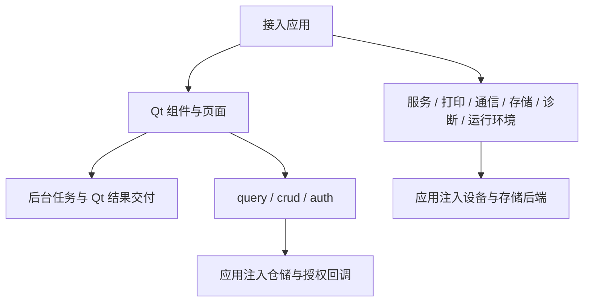

# 架构与依赖

## 版本基线

| 项目 | 当前声明 | 使用方式 |
| --- | --- | --- |
| 能力包 ID | `python.desktop` | 用于能力索引与 Demo 清单 |
| Python 发行名 | `common-tech-framework-desktop` | 安装和查询包元数据 |
| 导入名 | `ctf_desktop` | 在 Python 代码中导入 |
| 包版本 | `0.2.0` | 以 [pyproject.toml](../pyproject.toml) 和 [包版本常量](../src/ctf_desktop/__init__.py) 为准 |
| Python | `>=3.11` | 这是安装下限；没有声明上限，不等于所有更高版本都已验证 |
| 许可 | MIT | 见 [LICENSE](../LICENSE) |

包版本与源码提交是两个维度。同为 `0.2.0` 的不同提交也可能包含修复；接入应用应同时记录实际安装的 commit 或 wheel 的来源与校验记录。本地源码安装示例不依赖 PyPI 上存在同名版本，仓库合并也不代表包索引发布。

## 安装依赖

下表逐项对应 [pyproject.toml](../pyproject.toml)，依赖下限不代表验证过所有满足该范围的组合。

| 安装项 | 声明依赖 | 什么时候需要 | 不包含的内容 |
| --- | --- | --- | --- |
| 基础包 | 无第三方运行依赖 | 查询、CRUD 控制器、授权、服务、SQLite、日志、打印调度 | Qt、真实串口驱动 |
| `qt` | `PyQt5>=5.15` | 表格、表单、筛选、反馈、导航、管理页面、后台 Qt 交付、单实例锁 | PyQt6 / PySide 适配 |
| `serial` | `pyserial>=3.5` | 使用 `SerialTransport` 默认工厂打开真实串口 | USB 驱动、设备协议、系统端口权限 |
| `test` | `pytest>=8` | 执行核心测试 | Qt 和 pyserial |
| `all` | 上述三项之和 | 完整包测试或同时使用 Qt 与串口 | 打印机驱动、业务依赖、安装包工具 |
| 构建环境 | `setuptools>=77`、`wheel` | 从源码构建发行包；pip 使用隔离构建环境 | 接入应用的运行依赖 |

仅导入无界面模块无需创建 `QApplication`。`transport` 在默认工厂实际打开串口时才导入 pyserial；注入测试工厂可以避免真实硬件依赖。`runtime.AppPaths` 与 `load_json_config` 只用标准库，`runtime.SingleInstance.acquire()` 才需要 Qt 网络模块。

## 模块与调用方向

| 层 | 模块 | 应用需要提供 |
| --- | --- | --- |
| 基础逻辑 | `query`、`crud`、`auth` | 字段白名单、仓储、账号源、授权与校验规则 |
| 界面组合 | `table`、`forms`、`filters`、`feedback`、`navigation`、`crud_page` | 字段与列定义、主题、页面注册和错误呈现 |
| 异步交付 | `background` | 有限超时的 IO、协作取消检查、后台资源的创建和关闭 |
| 基础设施 | `services`、`printing`、`transport`、`storage`、`diagnostics`、`runtime` | 生命周期回调、打印提交、设备协议、业务迁移、数据目录 |

`crud_page` 组合既有组件，仓储调用仍在 Qt 事件线程；慢 IO 需要接入方另行安排异步加载。后台搜索只保留最新请求，不能直接替代必须逐条执行的写入或打印队列。

## 环境与资源条件

| 条件 | 接入要求 | 验证边界 |
| --- | --- | --- |
| Qt 事件循环 | 在 Qt 线程构造和调用组件；窗口应用提供 `QApplication` | offscreen 可以检查逻辑，不能证明真实窗口外观 |
| 后台 IO | 每个 worker 自建并关闭连接或句柄，设置有限 IO 超时并响应取消 Event | 不会强杀第三方阻塞线程 |
| SQLite | 使用 Python 的 `sqlite3`；迁移由应用定义；连接不能跨线程随意传递 | 标准明文 SQLite，不含 SQLCipher 或业务密钥 |
| 备份目录 | 目标目录可写且支持同文件系统硬链接；目标文件不得已存在 | 不支持硬链接时明确失败，无覆盖回退 |
| 串口 | 应用提供端口、协议、驱动和访问权限 | 假工厂测试不代表真实设备验收 |
| 打印 | 应用提供提交后端；Qt 打印 API 经同步 dispatcher 回 GUI 线程 | 模拟提交不代表真实打印机或驱动支持 |

字段、表结构、权限、设备指令、报表模板、加密和打包配置保留在应用侧。多项目收录按语言与领域组织，不通过 `sys.path` 引用兄弟包源码；跨包依赖需明确声明。

[安装步骤](快速开始.md) · [生命周期与线程](生命周期与线程.md) · [版本兼容与验证矩阵](升级与兼容.md)
