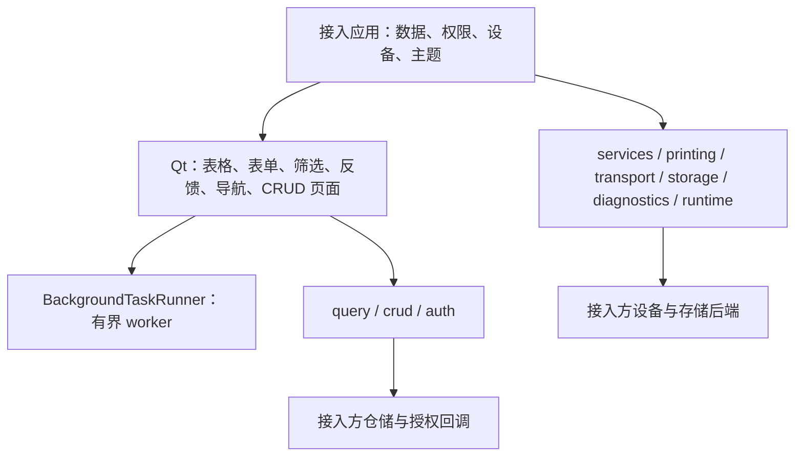

# 架构与依赖

## 分层

`crud_page` 组合现有组件，不建立第二套表单或查询。`table` 使用 query 的分页值对象。`crud` 只依赖 query；其余无界面机制可以单独导入。PyQt5 和 pyserial 都是可选依赖，只有对应组件或默认串口工厂使用它们。

## 保留在应用侧的内容

业务字段、表结构、账号数据、权限规则、设备指令与帧格式、报表模板、打印机选择、数据加密策略和发布配置。框架不假定医疗、库存或订单中的任何一种业务。

## 多项目收录

本包位于 `packages/python/desktop`；独立工程工具或其他语言的能力使用自己的语言/领域包。来源项目记录在溯源说明中，不作为复制目录。能力归并依据行为与契约，不依据函数名字相似。跨包依赖必须声明，不允许通过 sys.path 或直接引用兄弟包源码实现隐式依赖。

## 版本与资源

每个领域包独立版本化。模块没有全局数据库或全局应用单例；通过对象引用和回调明确资源所有权。详见 [线程与生命周期](生命周期与线程.md) 和 [兼容性](升级与兼容.md)。
