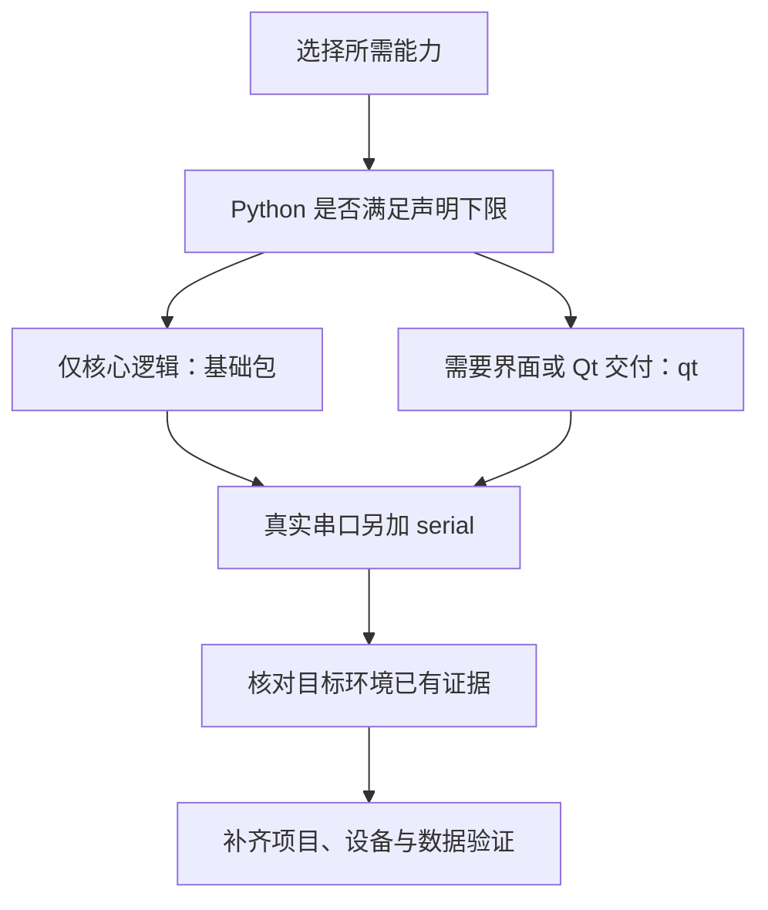

# 版本与兼容选择

展示页帮助判断功能是否合适，本页帮助判断能力能否接入当前项目。精确依赖、升级行为和环境矩阵统一维护在包文档。

## 先确认四个版本

| 维度 | 当前入口 | 为什么需要记录 |
| --- | --- | --- |
| 包版本 | Python desktop 为 `0.2.0`，见 [包配置](../packages/python/desktop/pyproject.toml) | 判断接口与依赖基线 |
| 源码提交 | 站点文档的源码入口或自己的 checkout commit | 同一包版本下仍可能有不同修复 |
| 运行环境 | [依赖表](../packages/python/desktop/docs/架构与依赖.md) | Python、Qt、串口与图形会话要求不同 |
| 应用数据版本 | 应用自己的 schema 与迁移清单 | 能力包版本不会替代业务数据库版本 |

## 按项目条件选择

| 你的情况 | 下一步 |
| --- | --- |
| 只用查询、授权、CRUD 控制器、日志或 SQLite | 安装基础包，从 [上手步骤](Getting-Started.md) 开始 |
| 使用 Qt 表格、表单、导航、异步搜索或单实例锁 | 安装 `qt`；确认 Qt 线程、事件循环和窗口环境 |
| 接入真实串口或打印机 | 阅读对应指南，准备系统驱动、权限和协议适配；模拟 Demo 不替代实机验收 |
| 既有项目从旧来源或 0.1.0 切换 | 固定目标 commit，检查 [兼容变化与降级](../packages/python/desktop/docs/升级与兼容.md) |
| 项目使用 Python 3.10、PyQt6 或 PySide | 不在当前声明的直接接入路径内；先评估适配，不能仅改依赖名当作兼容 |
| 使用 Windows 或其他尚未留存验证的环境 | 依赖可安装与目标平台验收分开，按 [验证矩阵](../packages/python/desktop/docs/升级与兼容.md#声明与验证矩阵) 补证 |

## 怎样读验证记录

声明下限表示包配置允许的范围；工作流表示计划执行的环境；某次测试记录只证明该次提交、解释器和依赖组合。离屏 Qt 不证明真实窗口、打印或设备驱动，浏览器交互也不执行 Python。

[完整依赖与资源条件](../packages/python/desktop/docs/架构与依赖.md) · [升级与验证矩阵](../packages/python/desktop/docs/升级与兼容.md) · [历史验证记录](../packages/python/desktop/docs/验证记录.md) · [上手步骤](Getting-Started.md)
