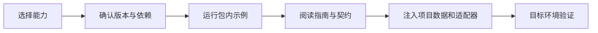

# 上手步骤

先在 [功能展示](https://weisiwu.github.io/ac-reusable-capabilities/) 体验效果，再根据自己的项目选择能力。需要查看具体属性、默认值、事件和调用代码时，进入对应包的指南与公开契约。

## 选择阅读路径

| 目标 | 起点 | 接下来 |
| --- | --- | --- |
| 第一次使用 | [能力地图](Capabilities.md) | [版本与兼容选择](Compatibility.md)，然后执行包快速开始 |
| 给现有应用增加能力 | [接入场景](Recipes.md) | 阅读模块指南、契约，注入自己的数据或设备适配 |
| 查询某个属性或异常 | [Desktop 手册](../packages/python/desktop/docs/README.md) | 查相应模块的公开契约与最小示例 |
| 升级旧版或迁移来源 | [版本与兼容选择](Compatibility.md) | 对照升级清单，在旧环境副本上验证 |

## 安装与第一次调用

当前已收录的 Python desktop 包为 `0.2.0`，安装声明为 Python `>=3.11`。基础包不要求 Qt；需要界面或 Qt 交付时选择 `qt`，真实串口选择 `serial`，测试选择 `test`。完整依赖版本与资源条件见 [架构与依赖](../packages/python/desktop/docs/架构与依赖.md)。

从克隆后的仓库根目录，在自己的隔离环境中安装：

```bash
python -m pip install './packages/python/desktop'
python demo/run.py desktop-core
```

看到 `Desktop example passed` 表示基础组合示例完成。虚拟环境、Windows PowerShell 步骤、可复制调用和属性表统一见 [桌面包快速开始](../packages/python/desktop/docs/快速开始.md)，避免在 Wiki 维护第二套安装手册。

## 接入流程



桌面演示的表格、表单、筛选、反馈、CRUD 和异步搜索使用临时数据与模拟后端。关闭示例窗口以释放它创建的资源；无图形会话可按快速开始执行 offscreen smoke，其结果不替代实机走查。

接入项目负责业务 schema、账号和权限、设备协议、报表、加密与发布。发行名为 `common-tech-framework-desktop`，导入名为 `ctf_desktop`；旧来源提供同名发行包，必须在隔离环境中明确选择一种来源并记录目标提交。安装库不会自动改造既有业务项目。

[版本与兼容选择](Compatibility.md) · [接入场景](Recipes.md) · [常见问题](Troubleshooting.md)
