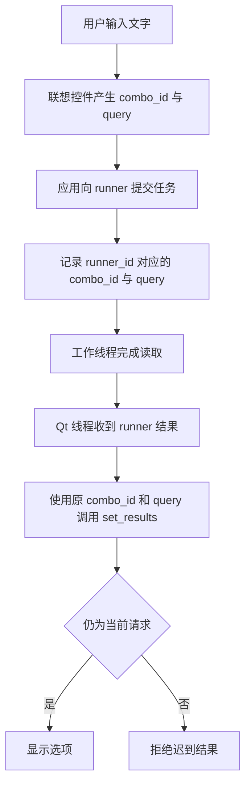
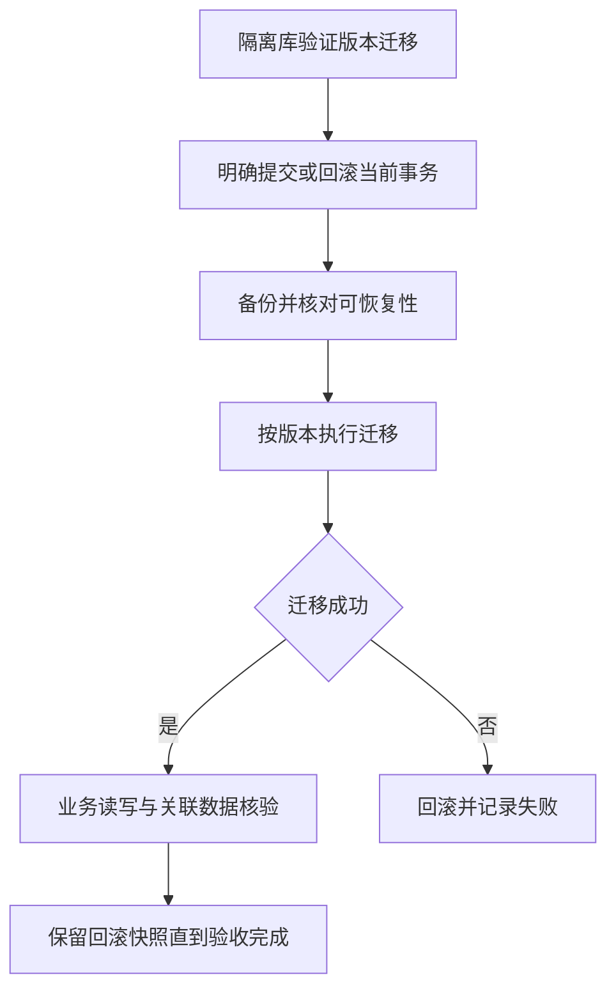

# 接入场景

以下路径使用已有实现；最小可执行代码位于链接的契约和示例，业务规则由接入应用提供。

## 场景选择

| 目标 | 组合能力 | 应用需提供 |
| --- | --- | --- |
| 筛选列表与翻页 | Filters → Query → Table | 查询白名单、仓储、总数 |
| 输入联想不阻塞界面 | Filters → Background | 有限超时的读取函数、结果 ID 映射 |
| 带权限的资料管理 | Auth → CRUD → CrudPage | 授权规则、仓储、字段配置 |
| 本地升级与恢复 | Storage | 版本迁移、停写协调、业务核验 |
| 可控启动和退出 | Services → Diagnostics | 工厂、依赖、清理回调、敏感键策略 |
| 多份打印或设备 IO | Printing / Transport | 打印后端、设备协议、线程派发与超时 |

先按 [兼容要求](Compatibility.md) 选择运行环境，再读对应指南；精确签名、默认值和字段位于包内契约，同一能力不在 Wiki 再维护另一份 API。

## 慢查询与联想输入

两个组件的请求编号各自生成；应用保留映射，不假定 `combo_id` 等于 `runner_id`。

1. `LiveSearchComboBox.request_started(id,query)` 捕获请求代次和文字。
2. `BackgroundTaskRunner.submit` 执行读取，操作观察取消 Event 并使用有限 IO 超时。
3. Qt 线程接收 runner 成功信号，取回原联想控件 ID，再调用 `set_results(query,rows,request_id=combo_id)` 拒绝旧结果。
4. 关闭时 `close()` 等待工作退出。后台操作自行创建和释放线程内的连接。

[可运行搜索](../packages/python/desktop/examples/background_search.py) · [后台指南](../packages/python/desktop/docs/guides/background.md) · [筛选契约](../packages/python/desktop/docs/contracts/filters.md)

## 带权限的资料编辑

| 阶段 | 失败后的含义 |
| --- | --- |
| 授权 / 校验 | 尚未写入，展示拒绝或字段错误 |
| 仓储写入 | 按仓储事务与幂等设计处理 |
| 写后通知 / 刷新 | 写入可能已经完成；先读取状态，避免重复创建 |

实现应用自己的仓储，把授权和校验传入 `CrudController`；先用无界面流程验证，再组合 `CrudPage`、`Column` 和 `FieldSpec`。权限在数据访问处检查，页面隐藏按钮不能替代授权。`CrudPage` 的仓储调用同步执行，慢 IO 应在接入层安排异步，不能直接阻塞 Qt 事件线程。

[组合 demo](../packages/python/desktop/examples/desktop_demo.py) · [CRUD 指南](../packages/python/desktop/docs/guides/crud.md) · [页面指南](../packages/python/desktop/docs/guides/crud_page.md)

## 本地迁移、备份与恢复

按递增版本提供 Migration，在隔离库验证迁移。备份前显式提交或回滚当前事务；恢复前停写并关闭外部连接，保留返回的回滚快照直到业务核验完成。`with SqliteStore(...)` 负责关闭，不隐式提交。

[存储指南](../packages/python/desktop/docs/guides/storage.md) · [失败恢复示例](../packages/python/desktop/examples/failure_scenarios.py)。当前是明文 SQLite，不包含业务 schema 或数据库加密。

## 服务启动与诊断

用 `ServiceSpec` 声明依赖，`ServiceRegistry` 拓扑启动、反序释放，启动失败尝试回滚；工厂返回前获得的资源由工厂自己清理。日志通过 `configure_json_logger` 配置轮转和结构化键脱敏，退出时关闭并移除自己的 handler。不要把隐私写入自由文本消息，结构化脱敏不覆盖任意文本。

[服务指南](../packages/python/desktop/docs/guides/services.md) · [日志指南](../packages/python/desktop/docs/guides/diagnostics.md) · [生命周期](../packages/python/desktop/docs/生命周期与线程.md)

## 打印与通信

打印 demo 的提交目标是内存，不会出纸；串口失败示例注入假句柄，不访问真实端口。真实项目注入设备调用并按实际线程要求派发；结果不确定的打印不能盲目自动重试。

[打印契约](../packages/python/desktop/docs/contracts/printing.md) · [通信契约](../packages/python/desktop/docs/contracts/transport.md) · [安全与数据边界](../packages/python/desktop/docs/安全与数据边界.md)
